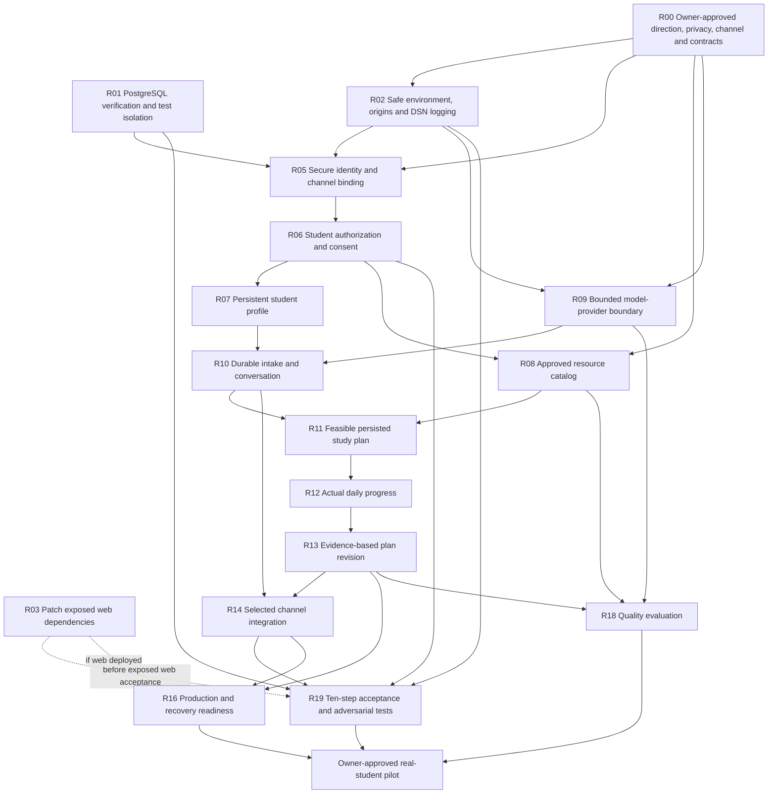

# KUNKOR — Consolidated Audit and Execution Roadmap

Report ID: `AUDIT-06-CONSOLIDATED`  
Inspection date: 2026-10-28; verification completed approximately 23:12 UTC.  
Inspected HEAD: `30212416c9e56d99019c562f421d805111bbc044`.  
Scope: evidence synthesis and proposed execution plan. No application code, existing decisions, migrations, or progress statuses changed.

## 1. Executive assessment

**Kunkor is a reusable technical foundation, not yet a usable educational consultant.** The implementation consists of a FastAPI health endpoint, a Persian RTL health-status page, five infrastructure tables, migration tooling, and a logging-only outbox dispatcher. No student identity, student profile, curriculum catalog, conversation, study plan, progress workflow, Telegram integration, or model provider exists in executable product code.

The database foundation works under the conditions tested: all eight existing tests passed against disposable PostgreSQL 16.15, and migration up/down/up passed. This corrects the available audit's environment-dependent failure assessment. It does not establish complete readiness: CI does not provision PostgreSQL, the test environment has versions outside declared requirements, and existing tests exercise infrastructure rather than student behavior.

**The largest architectural blocker is an unavailable product-direction record.** Neither `docs/vision.md`, `docs/plan-ai-consultant.md`, nor D-10 exists in this checkout or its reachable path history. The available specification and accepted ADRs intentionally defer AI and prohibit educational decision logic in prompts. This report uses the requesting owner's ten-step consultant scenario as the target for planning; it does not invent D-10's wording, approved scope, or decision status.

Preserve FastAPI, Next.js, PostgreSQL, the modular-monolith structure, migrations, append-only audit protection, and infrastructure tables. Build one consultant with validated proposals and backend-controlled writes. Start with a small approved resource collection and structured retrieval. A broker, vector database, autonomous tool execution, specialist-agent fleet, and model supervisor are unnecessary prerequisites for that first flow.

**Recommended next implementation task: R01 — restore PostgreSQL-backed verification in CI and local setup.** It is independent of the unresolved product direction and creates the verification gate needed for subsequent identity and schema work. R00 is an owner/architecture decision prerequisite for product implementation, not a second recommended implementation task.

## 2. Repository revision and audit coverage

### 2.1 Snapshot and provenance

- Repository: `/Users/sarasa/Documents/kunkor`.
- HEAD: `30212416c9e56d99019c562f421d805111bbc044`, committed 2026-10-23 06:01:59 −07:00, `feat(db): database migrations, base tables, and append-only triggers (TASK-02)`.
- Earlier commits: `fdfe7de2fd6764bdf53db15bd2fa3adec59f9acb` — architecture baseline; `8812c83570ca05082c0a1d12c6436a99f64ac2d5` — initial infrastructure.
- Initial tracked working tree: clean. `AUDIT_05_SECURITY_OPERATIONS.md` was already **untracked**. Thus this inspection is HEAD plus that external report, not an entirely committed evidence bundle.
- Searches covered tracked and untracked workspace files, alternative audit filenames, hidden files excluding dependency/build caches, and reachable history for the missing requested paths. No conversation attachments were supplied.
- `docs/spec.md` and `مشخصات قابل توسعه — پلتفرم جامع یادگیری و هدایت تحصیلی.md` are byte-identical. They are the same specification, not independent evidence.

Available report:

| Requested report | Available evidence | Revision comparability |
| --- | --- | --- |
| Audit 01 — repository status | Absent; no alternative located | Cannot compare |
| Audit 02 — backend/database | Absent; no alternative located | Cannot compare |
| Audit 03 — frontend/UX | Absent; no alternative located | Cannot compare |
| Audit 04 — AI consultant | Absent; no alternative located | Cannot compare |
| Audit 05 — security/operations | `AUDIT_05_SECURITY_OPERATIONS.md`; document ID `AUDIT-05-SEC-OPS` | Says TASK-00/01/02 baseline, but records no commit SHA or execution timestamp. Consistent with this development stage; exact same-revision inspection **unverified** |

Consequently, this is a consolidation of one available audit plus direct repository verification. There is no support for claiming agreement among five independent audits or a same-revision audit cohort.

Evidence fingerprints, SHA-256:

```text
AUDIT_05_SECURITY_OPERATIONS.md
c9f9334c4c46c0c9d008dd3fb1f0433953a0c8aee3099e30be68266d0c419b77
docs/spec.md
eec34b4de41d102ffc832e9ef401e727f006d6a28bcf86dae51e7644ef670471
docs/decisions.md
c887055c325874f60ad08d6c490dfc55604f2f32d3b5aba13b985a0ef3419c98
PROGRESS.md
eb167bd7578cf7985c6fe244b4e699b18d3aa5754829a7b90fb816969f537bd6
apps/web/package-lock.json
94222ff8701a6cb0e15de5023af2f97551d9f357c9b5a0666ea8e3b6057c467c
```

### 2.2 Authoritative documents and interpretation

- Present and read: `docs/decisions.md`, `docs/spec.md`, root `PROGRESS.md`, all eight ADRs, `master-prompt.md`, TASK-00/01/02 records, and the contracts README.
- Absent: `docs/vision.md`, `docs/plan-ai-consultant.md`, `docs/PROGRESS.md`. Root `PROGRESS.md` is the actual progress document. It marks TASK-00/01/02 done, TASK-03 onward todo; that describes completed foundation work, not completed product capabilities.
- `master-prompt.md` identifies decisions → specification → execution prompt as the repository's documentary precedence. The current request supplies a newer planning target. Neither source is silently overwritten here: explicit reconciliation is R00.
- No D-10 entry is present; the decisions log ends at D-09. D-01/02/03/04/06/07/08/09 remain `proposed`; only D-05 is `default-applied`. All ADR-1 through ADR-8 remain accepted as recorded.
- Documentary mention of an entity, endpoint, engine, or provider is not evidence it exists. Planned module directories are currently empty package placeholders.

### 2.3 Evidence register

References below identify inspected source, not merely audit assertions.

| Evidence ID | Source and observation |
| --- | --- |
| E01 | `app/main.py:4–23` under `services/api/`: one application endpoint, `/healthz`, plus FastAPI documentation routes; wildcard credentialed CORS |
| E02 | `app/core/config.py`; `app/core/db.py`: development DSN fallbacks, no production configuration guard, per-operation connections, no pool |
| E03 | `migrations/0001_baseline_schema.up.sql:4–94`: extensions; audit/outbox/idempotency/flags/entitlements only; nullable ownership IDs; no student tables or RLS policies; append-only trigger SQLSTATE `23505` |
| E04 | `app/workers/outbox_worker.py:12–77`: logging-only dispatcher, batch transaction, `SKIP LOCKED`, acknowledgment after logging, no bounded retry policy, only KeyboardInterrupt caught |
| E05 | `scripts/check_authz_matrix.py:23–53`: arbitrary nonempty dependency list or endpoint marker passes; no actual actor/action/resource matrix |
| E06 | `tests/conftest.py:7–16`; all five test modules: session-wide automatic DB migration, eight infrastructure tests, destructive migration round-trip |
| E07 | `.github/workflows/ci.yml:10–75`: no PostgreSQL service/setup, no migration-check step, no web lint execution, `npm ci || npm install`, two literal secret patterns, no dependency scan |
| E08 | `docker-compose.yml:2–69`, `services/api/init-db.sql`, `Makefile`: only dev DB initialized, no application migration startup step, test DB not created, services gated by DB liveness rather than schema readiness |
| E09 | `apps/web/src/app/page.tsx`, `layout.tsx`: Persian RTL health page only, browser fetch to configured API or localhost; no intake/chat/plan/progress UI |
| E10 | `apps/web/package.json`, lockfile: Next.js resolves to 14.2.35; eslint-config-next 14.2.15; glob 10.3.10; PostCSS 8.4.31 |
| E11 | API requirements and `pyproject.toml`: lower bounds without a lock; project metadata omits some runtime requirements listed in requirements.txt; Docker installs dev requirements |
| E12 | Both Dockerfiles: no non-root USER; web runs `npm run dev`; Compose has development settings and broadly published ports; no production overlay/runbook/backup automation in tracked files |
| E13 | `docs/decisions.md:56–78`, ADR-4/6, `docs/spec.md` §§1.1, 1.8, 2.6: old rule-first, optional-AI direction; OTP only proposed |
| E14 | `PROGRESS.md`, TASK records, ADRs, `packages/contracts/README.md`: baseline completion claims; no generated contracts, student domain code, AI implementation, or approved gates |
| E15 | `scripts/migrate_check.py:45–62`: destructive rollback/up/down/up and logging of full DSN; no target-isolation guard |
| E16 | `scripts/check_imports.py`: checks selected absolute ImportFrom paths ending in other modules' models/repo; no domain modules currently exercise it; not a full dependency/cycle checker |

In this register, `app/`, `tests/`, `scripts/`, and `migrations/` are relative to `services/api/` unless another path is shown. Line ranges identify inspected regions; sections elsewhere cite the same evidence IDs.

## 3. Verified implementation status

### 3.1 Executed verification

| Check | Actual result during this synthesis | Interpretation |
| --- | --- | --- |
| Ruff | `.venv/bin/ruff check --no-cache services/api`: passed | Existing Python lint passes |
| Mypy | `.venv/bin/mypy --cache-dir /tmp/kunkor-audit06-mypy services/api/app`: passed, 11 source files | Does not establish domain correctness |
| Web lint | `npm run lint`: passed | CI currently omits this command |
| Web types | `npm run typecheck -- --incremental false`: passed | Avoided rewriting tracked tsbuildinfo |
| Import and authorization scripts | `make import-check authz-matrix`: passed; authz enumerated 5 public/documentation routes | No implemented domain boundaries or protected routes were covered |
| Test collection | `python -B -m pytest --collect-only -q -p no:cacheprovider`: 8 tests | Confirms test inventory |
| Default local pytest | 8 setup errors in sandbox: TCP `Operation not permitted` | A sandbox failure, not a database logic failure |
| Database availability outside sandbox | Port 5435: no response; Docker daemon 29.4.1 available | No configured local Kunkor DB service running; daemon availability is a separate fact |
| Isolated pytest | Existing suite, PostgreSQL 16.15: **8 passed, 1 httpx deprecation warning**, 0.22s | Confirms tested foundation behavior under this environment |
| Isolated migrations | Existing convention check and `test_reversibility()` function: up/down/up passed | Baseline migration works on an isolated test database |
| Direct health smoke | TestClient GET `/healthz`: 200, `{"status":"ok"}` without PostgreSQL | Endpoint is liveness only, not readiness |
| CORS probes | Untrusted origin reflected on preflight and synthetic-cookie GET; no-cookie GET used `*`; credentials header true | Confirms unsafe future credentialed-origin policy; no browser/session exploitation claimed |
| Authz negative probe | Synthetic unprotected route with `Depends(lambda: None)` accepted by original checker | Confirms a false-positive security gate |
| Worker failure probe | Synthetic processing RuntimeError escaped `run_worker()` immediately | Confirms termination, not an internal infinite retry loop |
| Offline npm audit | Returned 0 vulnerabilities | Not authoritative; lacked current registry findings |
| Online npm audit | Exit 1; **5 affected package entries: 1 critical, 4 high** | Current advisory presence confirmed; not “5 independent CVEs” or proof of deployed exploitability |

The temporary DB used the cached `postgres:16-alpine` image ID `sha256:721873c34ceb9f8d8fc265984940dc982404c105f19ad51be9fdc5970a6080ea`, a random loopback-only port, memory-backed data, and an isolated test database. No existing database or repository migration was changed. The container was stopped and its removal verified. The temporary verification harness was `/tmp/kunkor_audit06_verify.py`; it invoked the unmodified suite and existing migration-check functions. DSN logging was disabled for that round-trip verification.

**Important limit:** installed FastAPI 0.109.0 and Uvicorn 0.27.0 are below declared requirements `>=0.110.0` and `>=0.28.0`. Other observed versions include Starlette 0.35.1, httpx 0.27.2, psycopg 3.3.4, pytest 8.4.2. These are valid observed results for the available environment, not a clean-install validation of requirements or a remote CI success. No dependency installation or lockfile change was performed.

Not executed: full `make check`, a clean production build, browser E2E/accessibility testing, remote GitHub Actions, production deployment, load test, backup restore, or external model/Telegram calls. No results are inferred for them.

### 3.2 Existing work worth reusing

- Database migrations and extension setup; keep additive migrations rather than resetting historical schema.
- Audit INSERT/UPDATE/DELETE protection demonstrated by existing tests. This is not proof of protection from database-owner actions such as TRUNCATE or disabled triggers.
- Idempotency storage and its uniqueness index. There is no request replay, request-hash comparison, or business-operation idempotency service yet.
- Outbox locking/transaction pattern and schema. Dispatcher is a stub; event delivery is not implemented.
- Feature flag and entitlement tables. Their existence does not provide runtime enforcement or an AI kill switch.
- FastAPI/OpenAPI generation, health smoke, Next.js Persian/RTL layout, existing lint/type tooling.
- Accepted modular-monolith, provider-boundary intent, structured-retrieval-first, versioned-history, and explicit student-ownership principles.

## 4. Cross-audit disagreements and corrections

Only one audit is available. The disagreements below are **Audit 05 versus source/runtime evidence**, not model-voting outcomes.

| Audit 05 claim/reference | Resolution | Roadmap consequence |
| --- | --- | --- |
| SEC-01 is a currently confirmed critical session-hijacking defect | Wildcard credentialed CORS is confirmed. Starlette already reflects arbitrary origins for cookie-bearing requests; the report's conditional wording misses this. But there are no implemented student sessions or private routes, so actual session hijacking is unproven | High conditional security risk; repair before protected endpoints are exposed. CORS is not authorization or a replacement for CSRF controls |
| SEC-02 implies committed production secrets | Predictable development defaults and missing production guards are confirmed. No real production key compromise was established | Keep local development usable; require explicit production credentials and redact DSNs |
| SEC-03: Next.js 14.2.15, five CVEs | Manifest lower bound is 14.2.15; lockfile resolves 14.2.35. Online audit still reports 5 affected package entries, including inherited eslint-plugin/config entries and many advisories | Patch against the resolved dependency graph; assess advisory reachability and migration compatibility; avoid `npm audit fix --force` as a plan |
| SEC-05: subrouters/FastAPI dependencies inherently evade inspection | Normal included routers become application routes. The demonstrated defect is accepting **any dependency** as authorization, without inspecting policy semantics or runtime enforcement | Replace heuristic with explicit security declarations plus behavioral authorization tests |
| Outbox poison events cause an infinite worker loop | Only KeyboardInterrupt is handled. A dispatch/DB exception terminates the worker and rolls back its DB transaction. Repeated failures would require an external restarter, not present in Compose | Address crash/restart, per-event failure isolation and idempotent effects if async delivery is selected |
| Dispatcher publishes events | It only logs, then sets processed_at. Current test checks acknowledgment, not delivery | Do not route essential MVP work through it; synchronous domain transactions suffice initially |
| Database tests/migrations fail, so baseline integrity failed | Default environment is unavailable; isolated PostgreSQL 16 passes all eight tests and round-trip migrations | CI/bootstrap is defective; no evidence justifies rewriting the database foundation |
| Docker daemon unavailable | Docker 29.4.1 is running in this inspection; no configured Kunkor DB at port 5435 | Historical environment status cannot be carried forward as a repository defect |
| No RLS means isolation is already broken | RLS is absent; the old spec §2.5 explicitly treats it as a later second layer. There are no student endpoints to demonstrate IDOR today | Backend relationship/ownership authorization is mandatory; RLS is a defense-in-depth decision, not a substitute |
| Telegram duplication is out of MVP | That reflects the old assumed scope. New request explicitly requires Telegram assessment; missing D-10 prevents knowing which channel is mandatory first | Choose primary channel in R00; if Telegram is selected, authenticated ingress and deduplication become MVP requirements |
| Pooling, separate dead-letter queue, zero npm findings are universal minimum prerequisites | Current scale/channel/jobs are unmeasured, and no real asynchronous workflow exists | Keep a bounded delivery failure state when needed; add a pool/broker only from measured need. Block exposure on relevant unresolved serious vulnerabilities, not a cosmetic total alone |
| “FAILED G0/G1” settles gate status | Missing gate artifacts and unmet requirements prevent demonstrating passage; audit did not record an authorized gate evaluation | Report **not demonstrated**, not an invented official gate decision |

SEC-04/06/07/08 are materially supported with the qualifications recorded below. No unavailable audit's references, severities, or results are fabricated.

## 5. Canonical defects, missing capabilities, concerns, and risks

Severity describes potential impact; priority describes delivery dependency. High confidence means directly observed source or a reproduced behavior. Missing-capability confidence applies to this checkout, not unknown deployments. Dependencies identify prerequisite roadmap tasks; recommended actions identify the owning task(s). Grouped symptoms share one issue rather than being counted again per channel, table, audit paragraph, or advisory inheritance path.

### Documentation discrepancy and owner decision

**I01 — Product-direction authority is incomplete.**
- Class: documentation discrepancy / product decision. Confidence: high for missing records; D-10 content unverified. Severity: High; P0.
- Original references: Audit 05 §2 old AI/Telegram assumptions; current synthesis request. Evidence/affected files: E13/E14; missing vision/consultant plan/D-10; `docs/decisions.md`, ADR-4/6, `docs/spec.md`, `PROGRESS.md`.
- Impact: implementations could satisfy the old rule-only MVP while failing the requested consultant product. Dependencies: owner inputs in R00. Action: R00 reconciles scope and proposes explicit amendments; do not change accepted statuses during synthesis.

### Confirmed defects

**I02 — Verification/bootstrap is not self-contained.**
- Class: confirmed infrastructure defect. Confidence: High. Severity: High; P0.
- Original references: Audit 05 §§3/4/8 migration and pytest failures. Evidence/files: E06–E08/E15; CI lacks DB; Compose creates dev DB only; automatic fixture requires test DB; migration checks absent from CI.
- Impact: clean CI/local verification cannot establish regression safety; even healthz's test is coupled to DB availability. Dependencies: no product decisions. Action: R01 provisions isolated PostgreSQL/test DB, runs migrations in CI, documents startup sequence, and scopes destructive checks safely. Passing isolated tests rules out the claimed inherent baseline failure.

**I03 — Credentialed CORS trusts arbitrary origins.**
- Class: confirmed configuration defect. Confidence: High. Severity: High conditional on credentialed private endpoints; P0.
- Original reference: SEC-01. Evidence/files: E01 and CORS probes; `app/main.py`.
- Impact: future cookie-based private responses could be exposed across origins; some wildcard responses also fail credentialed browser checks. Dependencies: origin/channel policy in R00 for production values. Action: R02 adds explicit environment origins and tests before private routes ship; R05 owns session/CSRF behavior.

**I04 — Deployment credentials are permissive; migration logs expose full DSNs.**
- Class: confirmed configuration/logging defect. Confidence: High. Severity: High for production misuse; P0.
- Original references: SEC-02; logging exposure additionally found here. Evidence/files: E02/E08/E15; config, Compose, migrate/migrate-check scripts and test DSN defaults.
- Impact: accidental production defaults, broadly exposed local DB, credentials copied into CI logs. No leaked real secret is established. Dependencies: R00 hosting/privacy choices for production. Action: R02 isolates development defaults, fails fast in production, restricts local DB publishing and redacts DSNs. R16 handles production delivery/secret rotation procedures.

**I05 — Resolved web dependencies have serious advisories.**
- Class: confirmed vulnerable dependency graph; runtime exploitation unverified. Confidence: High for registry findings. Severity: Critical registry classification; P0 before web exposure.
- Original references: SEC-03; Audit 05 §§6/8. Evidence/files: E10 and current online npm audit; package.json/lockfile. Affected entries: next (critical), postcss, glob, eslint-config-next, @next/eslint-plugin-next (high).
- Impact: potential availability, disclosure, or code-execution exposure where advisory conditions apply; glob CLI finding concerns tooling invocation. Dependencies: none to investigate; R00 determines whether web is an exposed MVP channel. Action: R03 selects a supported patched graph, aligned tooling and any minimal compatibility changes; evaluates actual affected routes/features.

**I07 — Authorization checker accepts unrelated dependencies.**
- Class: confirmed false-positive security gate. Confidence: High, reproduced. Severity: High; P0.
- Original reference: SEC-05. Evidence/files: E05; `scripts/check_authz_matrix.py`; synthetic route with a no-op dependency passes.
- Impact: developers can believe new student routes are protected when no authorization exists. Dependencies: R05 identity contract, R06 explicit policy contract. Action: R06 rejects undeclared/irrelevant dependencies and tests actual student/resource access. This issue concerns the checker; I12 concerns absent runtime security.

**I09 — Outbox acknowledges a logging stub and crashes on errors.**
- Class: confirmed stub behavior and reliability defect if used as delivery. Confidence: High. Severity: High when relied upon for required effects; P2 while MVP uses synchronous transactions.
- Original references: Audit 05 §§2/5/7 `OPS-01` (backlog label, not an independent issue). Evidence/files: E03/E04; outbox worker, placeholder wrapper, worker test.
- Impact: processed_at can mean only “logged”; an exception stops processing, rolls back batch acknowledgments, and could repeat prior external effects after restart. Dependencies: a real asynchronous use case and stable event contract. Action: R15 implements real dispatch, idempotent effects, bounded retry/failure state only when a core path actually needs async processing; otherwise leave it explicitly unused.

**I11 — Append-only violations use a uniqueness SQLSTATE.**
- Class: confirmed diagnostic defect. Confidence: High. Severity: Low; P2.
- Original reference: SEC-08. Evidence/files: E03; migration trigger line 12 and append-only tests.
- Impact: future exception translation/retry logic may misclassify prohibited mutation as duplicate data. Current trigger still rejects UPDATE/DELETE. Dependencies: R01; no product redesign. Action: R17 supplies a forward migration and asserts intended SQLSTATE without editing applied history.

### Architectural and quality concerns

**I06 — Dependency installation is not reproducible.**
- Class: architectural/build concern with observed environment drift. Confidence: High. Severity: Medium; P2, elevated if clean CI cannot install/test.
- Original reference: SEC-04; additionally E07/E11. Files: requirements*.txt, pyproject.toml, web install CI step; current FastAPI/Uvicorn below requirements.
- Impact: local green results need not predict clean CI or deployment behavior. Lower bounds are not evidence of actual tampering. Dependencies: R01/R03 ownership sequence. Action: R04 establishes one backend dependency source/lock workflow, strict lockfile installation, and fresh-environment checks.

**I08 — Claimed CI security/architecture coverage exceeds checks.**
- Class: architectural/testing concern. Confidence: High. Severity: Medium; P2.
- Original references: SEC-06, Audit 05 §3. Evidence/files: E07/E16; CI checks two strings, not general secrets or dependencies; web lint omitted; import checker covers selected ImportFrom paths, not complete boundaries/cycles.
- Impact: false assurance as modules grow. Dependencies: R01/R03; real module contracts for meaningful boundary tests. Action: R04 installs scoped secret/dependency gates and completes lint checks; strengthen boundary checks when the first modules provide real cases. Authz-specific behavior remains solely I07/R06.

**I10 — Containers are development artifacts.**
- Class: deployment hardening concern. Confidence: High. Severity: Medium (root alone was Low in Audit 05); P2, required before external pilot.
- Original reference: SEC-07; Audit 05 §4. Evidence/files: E12; both Dockerfiles and Compose.
- Impact: unnecessary runtime privileges, dev tooling in API image, web dev server, no verified production artifact. Dependencies: R02/R03 and selected channel. Action: R16 builds minimal non-root production images, TLS/configuration/readiness/backup procedures. Do not describe dev Compose as production deployment.

### Confirmed missing capabilities

**I12 — Secure student identity, authorization, and consent are absent.**
- Confidence: High. Severity: High; P0. Original references: Audit 05 §2 cross-student-data risk; E01/E03/E13/E14.
- Files/modules affected: empty `app/modules/`, missing identity/consent/policy models, `app/core/`, migrations. No account/session/guardian/consent tables or protected endpoints exist.
- Impact: no secure persistent student context; privacy rules cannot be enforced. This is an absent capability, not a demonstrated current student-data breach. Dependencies: R00/R01/R02. Action: R05 identity, then R06 authorization/consent/data-request controls; optional RLS is a separate defense decision.

**I13 — Persistent student intake/profile state is absent.**
- Confidence: High. Severity: High for target flow; P1. Original references: new synthesis; Audit 05 §2 unbuilt domain logic. Evidence: E03/E09/E14.
- Files/modules: planned profile/education modules, migrations, intake contract. Impact: preferences, time budget, grade, goals, educational history cannot persist. Dependencies: R06 and R00 approved field policy. Action: R07 implements minimal typed profile/history storage; R10 supplies conversational intake rather than a second profile store.

**I14 — Educational resource knowledge and approved retrieval are absent.**
- Confidence: High. Severity: High for target flow; P1. Original references: Audit 05 §2 unsupported educational claims; E03/E13/E14; spec §§2.3/2.7.
- Files/modules: planned curriculum/content, migrations, seed tooling. Impact: no approved sources or evidence-grounded plan material; names and module designs exist only in docs. Dependencies: R00 curriculum/licenses and R06. Action: R08 creates a small approved versioned catalog, filters, locators, and no-source behavior; R21 later expands coverage.

**I15 — Model-provider abstraction is only an architectural intention.**
- Confidence: High. Severity: High for an AI consultant; P1. Original references: Audit 05 §2 no external AI pathways; E14 and empty `app/ai/__init__.py`.
- Files/modules: planned `app/ai/`, core config. Impact: no live model, validated output, timeout, budget metering, or effective kill switch. Dependencies: R00 approved provider/data policy and R02 configuration. Action: R09 builds one narrow provider boundary, one implementation and a test double; no provider fleet required.

**I16 — Conversation, durable resume, and intake orchestration are absent.**
- Confidence: High. Severity: High for target flow; P1. Original references: current request; no equivalent claimed implemented in Audit 05. Evidence: E01/E03/E09/E14.
- Files/modules: planned conversation service, migrations, channel adapter. Impact: no multistep intake, turn history, correction, interruption recovery or ownership-bound state. Dependencies: R07/R09 and R06. Action: R10 uses an explicit durable state machine and idempotent turn handling; model suggestions cannot silently mutate state.

**I17 — Study planning and progress-based revision are absent.**
- Confidence: High. Severity: High for target flow; P1. Original references: Audit 05 §2 infeasible schedules/silent plan failures. Evidence: E03/E14; empty engines/modules.
- Files/modules: planning service, pure engine validation, plan/task/revision schema. Impact: no feasible draft, confirmation, persisted tasks, immutable revision history or change based on actual progress. Dependencies: R07/R08/R10; revision additionally R12. Action: R11 creates validated draft/activate lifecycle; R13 extends that same lifecycle to evidence-based revisions, not a parallel planner.

**I18 — Daily execution/check-in and progress evidence are absent.**
- Confidence: High. Severity: High for target flow; P1. Original references: Audit 05 §2 rules/planning incomplete; E03/E14.
- Files/modules: tasks/evidence services, migrations. Impact: no actual behavioral evidence to summarize or revise plans; idempotency table alone does not make business operations idempotent. Dependencies: R11. Action: R12 atomically records outcomes/evidence, supports correction via superseding events, handles student-local dates, exposes a modest sufficiency-aware summary.

**I19 — No usable student channel exists.**
- Confidence: High. Severity: High for target flow; P1 for one selected channel, P3 for another. Original reference: Audit 05 §2 Telegram marked N/A. Evidence: E01/E09/E14; no Telegram handler, credentials, webhook validation or polling loop.
- Files/modules: web page and planned channel adapter. Impact: health page is not intake, plan presentation, or check-in; Telegram claims are unsupported. Dependencies: R00 primary-channel choice and stable R05/R06/R10 contracts. Action: R14 implements the selected channel; R22 adds a second only when required. Reuse existing Persian RTL layout if web is selected.

**I20 — Consultant safety/quality evaluation is absent.**
- Confidence: High. Severity: High when serving model proposals; P2 systematic quality, with minimum validators/tests mandatory in P1 tasks. Original references: Audit 05 §2 educational/prompt risks; E06/E14.
- Files/modules: planned `app/ai/eval/`, engine tests and CI. Impact: no evidence the future consultant stays grounded, feasible, privacy-safe or useful in Persian. Dependencies: product fixtures from R00 and R08–R13 contracts. Action: R18 builds versioned evaluation and reviewer workflow; R11/R19 already gate unsafe outputs. A model supervisor is not a substitute.

**I21 — Multiple consultants and an automated supervisor are absent.**
- Confidence: High. Severity: Low for a single-consultant MVP; P3. Original references: current request; no implemented equivalent in Audit 05. Evidence: E14 and empty AI/modules.
- Files/modules: future consultant routing/evaluation only. Impact: expansion target unserved, but no evidence it blocks first usable consultation. Dependencies: R19/R18 plus owner demand and budget. Action: R20 first measures whether one consultant fails distinct use cases; add specialist routing or supervisor only if evaluation demonstrates value.

**I22 — Operational recovery and student-data lifecycle are unproven.**
- Confidence: High for missing repository artifacts; external infrastructure unverified. Severity: High before real student pilot; P2 release gate.
- Original references: Audit 05 §§4/5/9. Evidence/files: E01/E02/E08/E12/E14; no DB-aware readiness, structured request tracing, backup/restore proof, production runbook or retention/export/erasure implementation.
- Impact: outages may appear healthy; data loss or policy violations cannot be ruled out. Dependencies: R00 retention/hosting policy; R02 and actual domain schema. Action: R06 owns consent/export/erasure authorization and service behavior; R16 owns operational execution, recovery and redaction. Existing audit_history immutability must be reconciled with erasure, not globally disabled.

### Unverified risks — not additional confirmed defects

**I23 — Exploitability and scale-dependent safeguards remain unverified.**
- Class: unverified risk bundle, excluded from any defect total. Confidence: Low for actual occurrence; severity conditional, potentially High.
- Original references: Audit 05 §2 prompt injection, cross-student leakage, model leakage, excessive execution, and §§4/9 pooling. Evidence: future paths do not yet exist; no live model, student API, queue workload or production measurements were available.
- Affected future modules: AI/conversation/policy/retrieval/operations. Impact: injected resources, fabricated sources, leaked student context, unbounded cost or exhausted connections could defeat safe consultation.
- Dependencies/actions: R09 bounds calls and minimizes data; R06/R19 exercise ownership; R11 validates resource/plan proposals; R18 evaluates adversarial cases; R16 measures capacity. Do not prescribe RLS, pooling, vector retrieval, a broker, or multi-agent supervisors solely from these unproven hypotheses.

## 6. Product-vision alignment

This assessment uses the ten-step target supplied in the request, with legacy requirements retained unless explicitly superseded by an owner decision. No complete new vision document was available.

| Capability | Verified current status | Reusable foundation | Remaining gap / task |
| --- | --- | --- | --- |
| Conversational student intake | Absent | FastAPI and Persian UI shell | Validated questions, correction/confirmation, minimum-profile policy, resume: R07/R10/R14 |
| Persistent student profiles | Absent | PostgreSQL/migration tooling | Typed ownership-bound profile and historical changes: R05–R07 |
| Personalized study planning | Absent | Engine isolation and versioning intent | Grounded draft, time/prerequisite/grade validation, student confirmation: R08/R11 |
| Educational resource knowledge | Absent | Structured-retrieval-first ADR | Approved catalog, licensing, curriculum mappings, citations/no-source: R08 |
| Daily progress tracking | Absent | Idempotency table and append-only pattern | Transactional outcomes/check-ins/evidence and summary: R12 |
| Plan revision | Absent | Versioned-history specification | New revision driven by actual progress, concurrency check and confirmation: R13 |
| Telegram interaction | Absent | Transport-neutral backend can be reused | Decide primary/secondary; securely bind sender, deduplicate updates, present plans: R00/R14 or R22 |
| Model-provider abstraction | Docs only | ADR-6, empty AI package | Narrow validated call boundary, one approved model, budgets and failure behavior: R09 |
| Multiple AI consultants | Absent | Future routing can share provider/domain contracts | Establish benefit after one complete flow: R20 |
| Supervisor and quality evaluation | Absent | CI and planned golden-test approach | Deterministic checks now; offline/human quality evaluation R18; optional supervisor R20 |
| Security/student-data isolation | Ownership columns in infrastructure only | ADR-3/8, audit storage | Identity, deny-by-default policy, consent, ownership filtering and negative tests: R02/R05/R06/R19 |
| Deployment/operational reliability | Development configuration; narrow DB tests pass | Containers, liveness, migrations | CI DB lifecycle R01; patched exposed dependencies R03; production/readiness/recovery R16 |

The old five-stage, rule-first learning platform and the requested AI consultant overlap in profiles, resources, plans, evidence, revision and privacy. Those designs remain useful. Their old sequencing—AI only after a complete five-stage core—cannot be assumed correct for the new target. Conversely, the new request does not authorize pretending that all five age groups can be dropped, Telegram is the only channel, or model autonomy is approved. These are explicit R00 decisions.

## 7. Architecture decisions requiring attention

All recommendations below are **proposals**; recorded ADR and D-statuses remain unchanged.

### 7.1 ADR disposition

| Existing decision/status | Assessment | Evidence, alternatives, risks and consequence |
| --- | --- | --- |
| ADR-1 modular monolith — accepted | Compatible; retain | Small codebase and transactional domain fit one service. Alternative microservices add deployment/contracts without demonstrated need. Keep channel adapters and domain services in the existing API |
| ADR-2 Next.js/FastAPI/PostgreSQL — accepted | Compatible; patch versions and confirm channel role | Existing DB tests pass; no rewrite case. Telegram-first could defer rich web UX while preserving web code. Exposing old packages/dev server is unsafe; selected deployment must be tested |
| ADR-3 central backend authorization — accepted | Compatible; implementation missing | Current heuristic is not policy. Alternatives central actor/action/resource checks alone vs checks plus RLS. Retain mandatory central ownership enforcement; decide RLS separately, with tests and runtime DB-role design if selected |
| ADR-4 all educational logic in pure engines — accepted | Needs explicit interpretation/amendment for AI-generated plans | Strict reading excludes educational decisions in LLM prompts. Alternative A: model conducts intake/explanation while deterministic planner generates schedules. Alternative B: model proposes candidate plans, pure validators enforce feasibility/approved references and user confirms. Prefer B only with owner approval; otherwise A can deliver conversation with a deterministic planner. Risk: B produces fluent but unsuitable plans; consequence: schema/domain validators and versioned provenance become mandatory |
| ADR-5 temporal history/append-only evidence — accepted | Compatible; reassess privacy implementation | Preserve actual evidence and plan revisions. Alternative raw-conversation retention forever vs minimal structured facts plus bounded transcript retention. Retention/erasure may require controlled purge/pseudonymization and avoiding private notes in immutable evidence. Never weaken append-only constraints globally to implement deletion |
| ADR-6 optional AI, no critical P0 dependence — accepted | Conflicts if new product requires live AI for core consultation | Provider abstraction/kill switch remain useful. Old “AI optional after MVP” cannot describe an AI-first product. Alternative deterministic fallback supports data entry, plan viewing and progress during provider outage; it must not be reported as a successful AI consultation. Consequence: revise availability/acceptance semantics and budgets explicitly |
| ADR-7 structured retrieval before vectors — accepted | Compatible; retain | No resource corpus or retrieval benchmark exists. Start SQL filters and a small catalog; add full-text search as corpus needs justify. Vector search only after measured retrieval failure; no vector infrastructure on critical path |
| ADR-8 explicit student_id — accepted | Compatible; enforce on new domain records | Existing infrastructure ownership fields are nullable because system events may have no student. New student-owned rows need non-null ownership and constraints preventing cross-student references. A column alone is not isolation; mandatory repository filters and negative tests remain necessary |

### 7.2 Open product decisions and their blockers

| Record, current status | Required treatment | Blocks / alternatives / consequence |
| --- | --- | --- |
| D-10 — absent | Obtain actual approved direction or owner-approved replacement record; preserve source/version | Blocks claiming an approved AI-first architecture. R00 must define consultant role, channel, cohort, stage coverage, autonomy and acceptance; this synthesis does not assign D-10 accepted status |
| D-01 — proposed | Confirm curriculum version and minimum lesson coverage | R07/R08 need valid stage/track values; use synthetic fixtures only until approved. One limited pilot cohort is an option, not an authorized reduction of five-stage commitments |
| D-02 — proposed | Approve concrete source rights and two-review publication policy | R08 cannot offer real content merely because a license field exists. Alternative owner-created materials reduce ingestion scope; published approved resources required either way |
| D-03 — proposed | Defer expanded exam integrations/OCR | Does not block generic consultant loop; manual goals/results can be introduced later if owner requires them |
| D-04 — proposed | Confirm age/guardian consent, retention, export, erasure and model/Telegram data handling | R05/R06 and real-student pilot blocked until policy approved. Adult-only pilot is an owner option, not a legal assumption or permission to ignore minors in declared coverage |
| D-05 — default-applied | Confirm hosting/data region, TLS, runtime and model budgets | Local Docker remains usable. R09 needs approved provider budget; R16 needs hosting/backup responsibilities. No paid infrastructure commitment inferred |
| D-06 / D-08 — proposed | Defer payment and incentive logic | Reuse entitlement/completion foundations later; no billing system or completion-gated rewards needed for first consultation |
| D-07 — proposed | Reconcile with ADR-4/6 and AI-first target | Decide model suggestion authority, deterministic validation, fallback and quality thresholds. Do not confuse old spec P0/P1 phases with this report's delivery priorities |
| D-09 — proposed | Select secure identity and channel binding | Web OTP remains a possible method; Telegram verified sender binding with private chats is another. Do not require both by default; cross-channel linking needs an expiring single-use proof, never user-entered student_id |

Additional owner choices within R00: timezone/day definition; minimum intake fields; short planning horizon; weekly/daily effort limits; student confirmation and correction semantics; what student text may be sent to providers; transcript retention; quality reviewer; support/escalation behavior. These choices should be versioned in the eventual vision/decision records, not hidden in prompts.

### 7.3 Proposed minimum architecture

One authenticated channel calls the same backend service. Backend resolves the actor to an authorized student, loads durable conversation/profile state, retrieves approved resources, and calls one approved model through a small typed provider boundary. The model returns structured suggestions. Domain services validate facts, ownership, resource eligibility, scheduling constraints and current record versions. Only backend transactions write profile/turn/plan/progress records. Student confirmation activates plans and revisions.

Use PostgreSQL transactions and synchronous state transitions for essential writes. A provider timeout cannot leave a half-active plan. Duplicate requests must replay a durable result or an explicit recoverable state. Do not keep a DB transaction open across an external model request; persist turn/request identity and use optimistic state checks before committing the result. Start with one short-horizon planning policy and one provider implementation; no generalized agent framework is required.

## 8. Critical dependency graph

This is a logical dependency graph, not a measured calendar critical path. Team capacity and durations are unknown. R00 may be resolved concurrently with R01 and package investigation; no domain implementation should assume its unresolved answers.



Minimum implementation sequence after decisions: R01/R02 → R05 → R06 → R07 → R10 → R11 → R12 → R13 → completed R14 → R19. R08 and R09 proceed on parallel branches once their prerequisites hold. R14 can build its transport shell after identity, policy and turn contracts stabilize; it cannot be declared complete before plan/progress/revision integration.

The graph's final pilot gate deliberately includes P2 operational and quality work. P2 means it can follow core implementation, **not** that privacy, recovery or essential model safety can be omitted when real student data is introduced. R04's clean-install checks should finish before that gate as well. If asynchronous work is introduced into a core path, R15 moves onto that path; otherwise no broker/outbox completion is needed. R17's diagnostic correction is independent of delivering the flow.

For Telegram-first, R05 owns verified identity binding while R14 owns ingress authentication, deduplication and presentation; for web-first, R05 owns authenticated sessions while R14 owns accessible conversational UI. Neither option requires a second identity implementation.

## 9. Prioritized execution backlog

IDs `R00–R22` are **proposed roadmap tasks**, not replacements silently applied to the historical TASK-00–32 list. New module/file names below are proposed ownership locations; their appearance here does not assert they exist. Each task owns its unit/contract tests. R19 owns only cross-module acceptance tests.

Effort Small/Medium/Large is a relative estimate, not measured duration or a delivery commitment. Every task must retain existing passing behavior, supply evidence for its acceptance criteria, and avoid unrelated refactors.

### P0 — blocking foundations and safety

#### R00 — Reconcile the AI-consultant product contract

- **Problem/evidence:** I01, E13/E14; unavailable D-10/vision conflicts with old optional-AI sequencing and potentially ADR-4/6.
- **Files/modules:** proposed vision/consultant plan and ADR amendment drafts; decisions/progress references. This is a documentation and owner-decision task, not implementation.
- **Dependencies:** actual D-10 if it exists elsewhere; product owner, curriculum and privacy reviewers.
- **Priority/effort:** P0 / Medium.
- **Acceptance:** owner specifies cohort/stage coverage, primary channel, minimum profile fields, resource rights, model authority, confirmation rules, fallback behavior, retention, identity method and budgets; conflicts and any superseded requirements are explicit; no accepted ADR is silently relabeled. Preserve traceability to old FRs/tasks.
- **Required checks:** walk the ten-step scenario plus missing source, minor consent, provider outage and duplicate-message cases against the agreed contracts; reviewer sign-off, not invented automated results.
- **Risks:** optimizing for an unapproved narrow cohort or treating a mock response as an AI consultant.
- **Owner decisions:** D-10 text/status; D-01/02/04/05/07/09; whether ADR-4 allows model-proposed candidate plans; old five-stage release obligation. Deferral requires an explicit scope decision.

#### R01 — Restore PostgreSQL-backed verification in CI and local setup

- **Problem/evidence:** I02, E06–E08/E15; existing suite passes isolated PostgreSQL 16, but CI has no database and dev setup creates no test DB.
- **Files/modules:** `.github/workflows/ci.yml`, `Makefile`, test setup/documentation; `docker-compose.yml`/`services/api/init-db.sql` only where required for safe test DB setup; migration-check guard if needed. No domain migrations.
- **Dependencies:** existing PostgreSQL 16 image/CI service; no D-10 decision needed.
- **Priority/effort:** P0 / Medium.
- **Acceptance:** fresh CI creates an isolated test DB, waits for readiness, injects TEST_DATABASE_URL, runs all eight existing tests and up/down/up checks. Document explicit dev migration order and fresh/existing-volume test DB setup. Destructive round-trips run only against a deliberately isolated test target; application/dev DB must not be silently selected. Clean requirements installation is verified, rather than relying on this inspection's old FastAPI/Uvicorn environment.
- **Required tests:** full existing suite and migration conventions/round-trip on PostgreSQL 16; missing/not-ready DB fails clearly; normal application DB rejected by destructive harness; repeat verification on a newly created DB. Record real CI results before marking done.
- **Risks:** a test DSN accidentally points at useful data; workflow credentials/DSNs appear in logs. Do not use existing named volumes or production databases for round-trips.
- **Owner decisions:** none about product scope; infrastructure access remains subject to normal execution permissions.

#### R02 — Enforce safe environment, origin and credential configuration

- **Problem/evidence:** I03/I04; E01/E02/E08/E15; runtime origin reflection and full-DSN logging confirmed.
- **Files/modules:** `app/core/config.py`, `app/main.py`, migration-check logging, Compose environment/port configuration, configuration tests.
- **Dependencies:** R00 production-origin and hosting policy for final deployed values; implementation can use explicit development/test values while those are pending.
- **Priority/effort:** P0 / Medium.
- **Acceptance:** production refuses missing/development credentials, origins are explicitly allowed, unsupported credentialed origins receive no allowed-origin response, local DB publishing defaults to loopback, DSNs/secrets are redacted. Preserve simple local development through explicit dev configuration.
- **Required tests:** dev/test/prod settings matrix; allowed/disallowed origins, preflight and cookie cases; missing required credentials; log redaction. Do not mistake successful server headers for a complete browser security test.
- **Risks:** CORS changes break legitimate channel origins; configuration makes local tests unusable.
- **Owner decisions:** approved origins, credential transport and hosting policy; CSRF belongs to R05 session design.

#### R03 — Patch and validate the exposed web dependency graph

- **Problem/evidence:** I05, E10; online npm audit confirms next/postcss and glob/tooling advisories, resolved Next.js 14.2.35.
- **Files/modules:** `apps/web/package.json`, lockfile, Next/ESLint configuration; minimal compatibility changes to web source if required.
- **Dependencies:** no product decision to investigate/patch; selected exposed channel determines release blocking scope.
- **Priority/effort:** P0 before web exposure / Medium.
- **Acceptance:** supported compatible Next.js/React/tooling versions selected from actual advisories; no unresolved relevant critical/high finding without documented owner/technical risk treatment. Explain remaining non-reachable/tooling findings rather than suppressing audit output. Preserve existing Persian RTL health-page behavior.
- **Required tests:** strict `npm ci`, lint, typecheck, production build and health-page smoke; online audit with resolved versions and advisory references; verify any Next upgrade deployment requirements.
- **Risks:** current audit's suggested fix includes a major upgrade; blindly forcing it can break config, lint command or runtime behavior.
- **Owner decisions:** only if a supported fix demands a material platform change or residual risk acceptance; no authorization to leave an exposed critical issue unresolved is inferred.

#### R05 — Implement secure identity and channel-to-student binding

- **Problem/evidence:** I12/I19; E01/E03/E13; no user/session/channel identity implementation.
- **Files/modules:** proposed `app/modules/identity/`, minimal student/profile ownership creation boundary, core authentication helpers, additive identity/ownership migrations and tests; integration point in `app/main.py`.
- **Dependencies:** R00 identity/age/channel decisions; R01; R02. Web patching can proceed separately.
- **Priority/effort:** P0 / Large.
- **Acceptance:** validated actor identity maps to a durable internal subject; no client-provided student ID establishes identity. Create the agreed minimal student ownership root before R06 adds consent/ownership foreign keys; R07 enriches this same student/profile record, without creating a second identity. If web OTP: expiry, attempt limits, session rotation/revocation, secure cookies and CSRF controls where applicable. If Telegram: trust only transport-verified sender identity and private chat, never display names/forwarded text; expiring single-use linking proof if linking is required. Do not implement two login methods unless approved.
- **Required tests:** invalid/expired/replayed credentials, brute-force limits for chosen method, revoked identity, forged student/channel binding, cross-channel linking replay, logout/session invalidation where applicable. Test doubles cannot be enabled in production.
- **Risks:** fake production OTP, account takeover, treating Telegram username or submitted student_id as authentication.
- **Owner decisions:** D-09 method; whether accounts can own multiple managed students; selected provider availability and budget.

#### R06 — Enforce student authorization, consent and data rights

- **Problem/evidence:** I07/I12/I22; E03/E05/E13; actor/action/resource checks and age/consent controls do not exist.
- **Files/modules:** proposed core policy dependency, identity consent/data-request services, checker, additive consent/policy migrations; policy tests. R05 remains sole owner of login/session code.
- **Dependencies:** R05; R00 age, scope, retention/erasure and provider-data decisions; R01.
- **Priority/effort:** P0 / Large.
- **Acceptance:** student context resolved server-side; protected routes default-deny; repositories require authorized student scope; arbitrary FastAPI dependencies cannot satisfy the gate. Record policy-version consent and immediate revocation. Implement authorized export/deletion request handling and the approved pilot data-lifecycle behavior, including private conversation data. If minors are in scope, required guardian consent/managed-account behavior must work before enrollment; a full guardian dashboard can wait.
- **Required tests:** actor × operation × self/other student, managed-student scope, expired/revoked consent, staff denial, no-op dependency rejected, missing-policy route rejected; cross-student FK/reference rejection; export isolation and deletion/retention behavior. Extend matrix whenever later tasks add routes.
- **Risks:** ownership columns without filtering; a guardian sees private notes; erasure conflicts with immutable evidence.
- **Owner decisions:** D-04 and retention policy; RLS as optional second layer. If selected, define runtime DB role and connection-context reset tests; do not replace backend checks with RLS.

### P1 — first usable consulting workflow

#### R07 — Persist the minimum student profile and educational context

- **Problem/evidence:** I13; E03/E14; no student/profile/history model.
- **Files/modules:** proposed profile/education service and repository, additive enrichment of R05's minimal ownership record, educational-history schema, profile contract/tests.
- **Dependencies:** R06; R00 minimum profile, curriculum and age decisions.
- **Priority/effort:** P1 / Medium.
- **Acceptance:** store only approved fields sufficient for a short plan: educational stage/curriculum, goals, available time, relevant baseline and constraints. Distinguish missing/unconfirmed facts from accepted facts. Profile survives reconnect; edits retain required provenance/history; stage changes preserve past context. Prevent overlapping educational history if that entity is retained under ADR-5.
- **Required tests:** invalid combinations and time values, Persian/Latin numeral normalization, other-student access denial, save/reload, concurrent edits, historical/non-overlap constraints where applicable.
- **Risks:** overcollecting sensitive personal details; free-text model output treated as confirmed fact.
- **Owner decisions:** approved intake fields and sufficient-profile threshold; school-year/stage values from D-01.

#### R08 — Supply a small approved educational resource catalog

- **Problem/evidence:** I14; E03/E13/E14; no licensed resources or retrieval code.
- **Files/modules:** proposed curriculum/content service, additive curriculum/resource/version/license/review schema, small import/seed tool. No object-storage/ingestion framework unless approved content requires it.
- **Dependencies:** R00 curriculum and rights decisions, actual owner-supplied content and independent approvals; R06.
- **Priority/effort:** P1 / Large.
- **Acceptance:** owner-approved MVP subject/stage coverage has versioned resources with stable identifiers, durations/prerequisites where needed and useful locators. Publication enforces approved license/educational reviews, rights and expiry. Selection filters stage/curriculum/objective and currently authorized versions. Empty coverage returns a clear no-source result. Synthetic content remains labeled and cannot count as real pilot coverage.
- **Required tests:** missing/expired rights, identical reviewers where distinct reviewers required, unpublished/withdrawn source exclusion, wrong-stage exclusion, correct citation identity, unsupported objective and no-source behavior.
- **Risks:** rights or curriculum accuracy delay availability; building a full extraction pipeline before possessing approved content.
- **Owner decisions:** D-01/D-02; real MVP content list and reviewers. Any coverage reduction requires R00 authorization.

#### R09 — Add one bounded, typed model-provider boundary

- **Problem/evidence:** I15/I23; empty AI package; provider pattern exists only in ADR-6.
- **Files/modules:** proposed `app/ai/provider.py` and minimal model configuration/output schemas, tests; no autonomous tool framework.
- **Dependencies:** R00 model authority, data policy, budget and outage behavior; R02. Independent of resource implementation through stable input schemas.
- **Priority/effort:** P1 / Medium.
- **Acceptance:** one approved provider plus deterministic test double; strict output validation; explicit model/prompt version; deadlines, bounded attempts/concurrency/input/output limits; safe cost/usage metadata; effective kill switch. Remove identity fields from external context per approved policy. Model has no DB handle, arbitrary URL/file access or direct write capability. Provider outage preserves previously saved state and shows a truthful recoverable message.
- **Required tests:** malformed/oversized output, timeout, rate limit, budget exhausted, kill switch, provider unavailable, PII minimization, unexpected tool/action fields rejected; no persistence on invalid proposal.
- **Risks:** stateful API behavior or retry charging duplicates; production accepts a mock as success.
- **Owner decisions:** provider/model, processing region/terms, retention/training policy, spending limits and human escalation. Model identity choices do not justify building multi-provider routing now.

#### R10 — Implement durable conversational intake and resume

- **Problem/evidence:** I16; no conversation code/tables; target steps 1–4 and 10 unserved.
- **Files/modules:** proposed conversation service/repository and turn schemas, additive conversation/turn/request-state migrations; versioned intake prompt. R07 owns profile semantics; R09 owns provider calls.
- **Dependencies:** R06/R07/R09; R00 field-confirmation and completion rules.
- **Priority/effort:** P1 / Large.
- **Acceptance:** ask missing questions without inventing profile facts; student confirms material facts; service validates and atomically persists accepted changes/turn state. Store durable last-completed/pending state and request identity; reconnect/process restart resumes correctly. Per-conversation optimistic versioning or serialization prevents concurrent turns overwriting each other. Bound context; persist confirmed facts independently of transcript retention.
- **Required tests:** interruption before/after commit, duplicate same request, same ID with altered body, concurrent turns, correction of prior answer, malformed model proposal, provider failure, cross-student conversation IDs. No long DB transaction around model latency.
- **Risks:** unlimited transcript growth, stale model completion overwrites newer state, repeated intake after every restart.
- **Owner decisions:** exact intake sufficiency and confirmation UX; transcript retention and permissible sensitive topics.

#### R11 — Generate, validate, persist and present a feasible study plan

- **Problem/evidence:** I17/I14/I23; no planner; target steps 5–7.
- **Files/modules:** proposed planning service and pure validation/feasibility functions in `app/engines/`; additive plan/task schema; conversation planning transition; plan response contract.
- **Dependencies:** R07/R08/R10; R06 ownership. R00 selects deterministic generation versus model-proposed candidates under ADR-4.
- **Priority/effort:** P1 / Large.
- **Acceptance:** short-horizon draft respects confirmed available minutes, dates/timezone, stage, prerequisites, objective coverage and approved resource IDs. Student sees assumptions/citations and confirms before activation. Persist validated plan/version/tasks atomically with provenance and request identity. Insufficient time/content produces an explanation or question, not an empty or fabricated plan. Domain validators enforce safety regardless of generation method.
- **Required tests:** normal and zero/insufficient time, impossible deadline, unapproved or hallucinated resource, wrong stage, missing prerequisites, duplicate creation, concurrent confirmation, interrupted activation, unavailable provider; no invalid active plan committed.
- **Risks:** plausible prose hides infeasible allocation; large scheduling optimizer replaces a sufficient short-horizon policy.
- **Owner decisions:** horizon, maximum effort/break policy, accepted feasibility rules and whether user confirmation activates a plan.

#### R12 — Record actual progress and produce a sufficient-data summary

- **Problem/evidence:** I18; no execution/evidence/check-in paths; target step 8.
- **Files/modules:** proposed tasks/evidence services and progress contract, additive execution/check-in/evidence schema; reuse idempotency storage.
- **Dependencies:** R11 and R06; approved timezone/day and correction rules from R00.
- **Priority/effort:** P1 / Medium.
- **Acceptance:** done/skipped/postponed outcomes, relevant actual time/results and short daily check-in are recorded against owned plan tasks. Same key/body replays; changed body fails explicitly; business write and evidence are atomic. Corrections append superseding evidence, preserving history. Summary distinguishes self-reported execution from inferred mastery, displays sufficiency, and never uses private notes as public evidence.
- **Required tests:** duplicate/reordered submission, late entry/day boundary, Persian numerals, invalid outcome/result, other-student task ID, transaction rollback, evidence immutability and superseding correction; summary reproducible from accepted evidence.
- **Risks:** attendance mistaken for learning, double-counted corrections, wrong local date.
- **Owner decisions:** minimum check-in fields, self-report semantics and sufficiency thresholds; no psychological/academic diagnosis inferred.

#### R13 — Revise a plan using recorded progress

- **Problem/evidence:** I17; no revision implementation; target step 9.
- **Files/modules:** extension of R11 planning service/schema contract, progress-to-revision transition in conversation service; revision tests. Do not create another planner.
- **Dependencies:** R11/R12/R10 and R06.
- **Priority/effort:** P1 / Medium.
- **Acceptance:** explicit revision uses actual execution summary plus updated constraints; new plan version records parent, evidence window and reason; prior plan remains readable. Student confirms changes. Same feasibility/source checks apply. Conflict detection prevents overwriting a newer active revision; completed history is not reassigned or erased. Insufficient evidence is stated; user-requested load reduction may still be offered without claiming mastery.
- **Required tests:** missed-work/load-adjustment scenario, evidence window correctness, insufficient evidence, stale revision token, duplicate request/confirmation, existing completed task preservation and reconnect to latest active plan.
- **Risks:** blindly increasing workload, losing historical execution links, repeatedly revising after duplicate channel updates.
- **Owner decisions:** allowed automatic changes versus suggestions, revision triggers, carryover and maximum load-change policy.

#### R14 — Integrate the selected student channel

- **Problem/evidence:** I19; current web only displays health; Telegram absent.
- **Files/modules:** **web-first:** `apps/web/src/app/` and minimal conversation/plan/progress components; **Telegram-first:** proposed API Telegram adapter/transport module. Only the chosen branch is in scope. Stable backend contracts are owned by their domain tasks.
- **Dependencies:** R00 selected channel, R05/R06/R10 contracts to start; R11/R12/R13 to complete. R03 before exposed web use.
- **Priority/effort:** P1 / Medium.
- **Acceptance:** student can authenticate, answer intake, view/correct profile, confirm plan, check in, request revision and resume. Web: Persian RTL, keyboard access, readable pending/errors and mobile use. Telegram: verified webhook secret/TLS or approved single polling consumer; strict payload/size validation, private-chat restriction, update-ID deduplication, message length/rate limits and safe retry behavior. Persist incoming update/request before acknowledging; outgoing retry cannot duplicate domain changes. Account-binding logic remains in R05.
- **Required tests:** selected transport's forged/duplicate/delayed requests, disconnection/reconnect, stale action buttons, pending provider errors and core navigation; web keyboard/RTL/mobile smoke or Telegram synthetic webhook/polling fixtures. Group chats cannot expose student data.
- **Risks:** building both channels doubles integration; provider latency exceeds webhook budget. If durable async replies become necessary, R15 becomes a dependency; a new broker still is not mandatory.
- **Owner decisions:** primary channel, reply delivery expectations, Telegram privacy/age suitability, supported locale and accessibility requirements.

#### R19 — Prove the complete consultant scenario and security boundary

- **Problem/evidence:** I12–I20/I23; existing eight tests do not cover any student flow.
- **Files/modules:** new cross-module acceptance/security tests and fixture corpus, test report; CI integration only through the scheduled shared-file owner. No business implementation or duplicate unit tests.
- **Dependencies:** R00/R01/R02/R05–R14; R03 when web is exposed. Unit/security contract tests from each owning task must already pass.
- **Priority/effort:** P1 / Medium.
- **Acceptance:** all ten steps in §11 pass on persisted data across an actual process restart using the selected channel. Synthetic CI uses a deterministic provider; a separately labeled approved-provider smoke demonstrates real AI integration before claiming an AI pilot. Adversarial branch proves no other-student reads/writes or unvalidated model commits. Owner receives versioned evidence, unresolved limitations and coverage by approved cohort.
- **Required tests:** end-to-end happy flow plus insufficient profile/source/time, minor consent denial where applicable, malicious resource text, fabricated citation, cross-student ID, provider outage, duplicate update/write, interrupted commit, stale revision and restart recovery. CI mocks do not prove live model quality.
- **Risks:** one happy-path video hides state/isolation defects; live smoke leaks real student data or incurs unapproved spend.
- **Owner decisions:** approved acceptance cohort, live-test credentials/budget, reviewer and pilot go/no-go. No fabricated real-user field results.

### P2 — reliability and quality

#### R04 — Make installation and CI quality gates credible

- **Problem/evidence:** I06/I08; E07/E11/E16, out-of-range local dependencies and missing lint/security checks.
- **Files/modules:** backend dependency metadata/lock workflow, `.github/workflows/ci.yml`, import checker tests and minimal checker changes. Web package fixes remain owned by R03.
- **Dependencies:** R01 and R03 complete their CI/dependency changes first; domain contracts for meaningful import-boundary fixtures.
- **Priority/effort:** P2 / Medium; complete fresh-install checks before real pilot.
- **Acceptance:** one authoritative backend runtime dependency definition with reproducible installs and deliberate updates; web install never falls back from ci to install; lint/type/dependency/secret gates actually run. Secret scanning uses scoped robust tooling with documented exclusions. Boundary checks reject representative prohibited imports/cycles within the adopted contract rather than claiming to prove arbitrary SQL ownership.
- **Required tests:** fresh environment installation and existing suite, lock drift failure, seeded synthetic-secret detection with no real secrets, allowed/disallowed import fixtures, web lint execution. No global npm/Python environment dependence.
- **Risks:** lock maintenance burden; scanning generated artifacts or the audit report itself causes noisy failures. Do not call the current literal-pattern step a working security scan.
- **Owner decisions:** maintenance owner and update cadence; no new runtime infrastructure needed.

#### R15 — Make asynchronous delivery safe only where needed

- **Problem/evidence:** I09, E04; stub acknowledgment and process termination on failure.
- **Files/modules:** existing outbox worker/test, additive delivery-state migration only if selected async workflow needs it.
- **Dependencies:** R01, stable event payload/ownership contracts from the consuming domain, R06; real delivery requirement chosen in R14/R16.
- **Priority/effort:** P2 / Medium; becomes blocking before any essential async path uses this worker.
- **Acceptance:** real delivery handler exists; acknowledgments follow defined successful handling; per-event bounded retries/backoff and terminal failed state permit inspection/replay; consumer effects are idempotent across crash-after-send-before-ack. Worker survives isolated failures and can shut down/restart safely. A failure table/state in PostgreSQL is sufficient; no separate dead-letter service required.
- **Required tests:** handler failure, crash between send/ack, duplicate delivery, poison event isolation, exhausted attempts, recovery/replay, concurrent `SKIP LOCKED` workers. Verify effects, not merely processed_at.
- **Risks:** claiming exactly-once external delivery; blocking a whole batch; adding broker complexity without demand.
- **Owner decisions:** which effects need async delivery, acceptable latency and retry ceiling. If none, do not activate the stub or build a broker.

#### R16 — Prepare production deployment, observability and recovery

- **Problem/evidence:** I10/I22, E01/E02/E08/E12/E15; dev images and no proven recovery.
- **Files/modules:** Dockerfiles/production deployment configuration, readiness endpoint, safe structured request/error logs, backup/restore procedures, pilot runbook. Core auth/config semantics remain R02/R05/R06-owned contracts.
- **Dependencies:** R00 hosting/retention policy; R01/R02; R03 if web deployed; stable R13/R14 schemas/channel. R15 only if async critical path selected.
- **Priority/effort:** P2 / Large; required before real-student pilot.
- **Acceptance:** non-root production artifacts, no web dev server, TLS/secret injection, migration-before-service readiness, DB-aware readiness distinct from liveness, provider/worker error visibility without student text/PII, bounded request/model concurrency and a support runbook. Backup restores into an isolated target and preserves profile/plan/progress consistency. Retention jobs execute R06's approved privacy contract, including backups; record measured restoration results against owner-approved objectives.
- **Required tests:** production image build/start as non-root, schema-not-ready/DB-down readiness, timeout/crash recovery, log redaction, restore-and-read student flow, moderate representative load. Add pooling only if measurement reveals a connection bottleneck.
- **Risks:** tests accidentally touch production backups; database-owner runtime credentials defeat isolation; logs retain student identifiers/text.
- **Owner decisions:** region, runtime DB privileges, support/incident owner, RPO/RTO/load targets (old values are proposals), retention and secret rotation process. No deployment authorization is requested by this synthesis.

#### R17 — Correct append-only error classification

- **Problem/evidence:** I11; trigger rejects mutation using `23505`.
- **Files/modules:** one new forward/down migration replacing function behavior; `tests/test_append_only.py`.
- **Dependencies:** R01; coordinated migration slot.
- **Priority/effort:** P2 / Small.
- **Acceptance:** chosen integrity/permission SQLSTATE distinguishes append-only rejection from uniqueness; INSERT still works; UPDATE/DELETE remain prohibited; historical migration 0001 is unchanged.
- **Required tests:** SQLSTATE-specific mutation tests, uniqueness still distinguishable, migration up/down/up. Do not only match exception text.
- **Risks:** callers currently interpreting all 23505 as duplicates; rollback must restore old behavior predictably.
- **Owner decisions:** no product decision; technical owner selects a documented SQLSTATE consistent with API error translation.

#### R18 — Establish consultant quality evaluation and human review

- **Problem/evidence:** I20/I23; no educational/AI evaluation corpus or measured quality.
- **Files/modules:** proposed `app/ai/eval/`, curated synthetic evaluation fixtures, reviewer rubric/results and CI hooks through shared-file owner.
- **Dependencies:** R00 rubric/reviewer; R08/R09/R10/R11/R12/R13 stable behavior. May prepare fixtures earlier without modifying service interfaces.
- **Priority/effort:** P2 / Medium; essential release thresholds must pass before real pilot.
- **Acceptance:** versioned Persian cases assess intake completeness, grounded citations, feasible schedules, progress-sensitive revision, no-source honesty, injected-content resistance, student isolation, recovery and bounded cost. Compare prompt/model versions before promotion. Human educational review accompanies automated checks. Deterministic ownership/source/time invariants have zero allowed violations; subjective usefulness thresholds are approved by owner, not invented here.
- **Required tests:** evaluation runner deterministic against recorded fixtures/test double; controlled approved-model evaluation reports real outputs, cost and failures; regression demonstrates bad proposals are rejected rather than accepted by a supervisor model.
- **Risks:** model grades itself, tiny corpus overstates coverage, fixture prompts contain real student information.
- **Owner decisions:** educational reviewer, pass criteria, cohort coverage, spend and promotion policy. Automated supervisor remains R20 expansion.

### P3 — expansion after a demonstrated single-consultant MVP

#### R20 — Evaluate and introduce specialist consultants/supervision when justified

- **Problem/evidence:** I21; no specialists or supervisor; no demonstrated need yet.
- **Files/modules:** optional consultant routing/prompt configurations and evaluation cases, reusing existing provider and domain services; no separate persistence stack.
- **Dependencies:** R19/R18 and evidence of distinct unmet consultation needs; explicit owner authorization.
- **Priority/effort:** P3 / Large.
- **Acceptance:** comparative evaluation identifies measurable benefit over one consultant; routing has one student-scoped context, bounded call graph/cost and a single backend write authority. A supervisor, if approved, advises or flags review; it cannot bypass validators. Stop without orchestration if no benefit is established.
- **Required tests:** single-versus-specialist benchmark, routing errors, conflicting proposals, cost/retry ceilings and cross-consultant student isolation; supervisor false positives/negatives.
- **Risks:** latency/cost increase and divergent advice masquerade as improved quality.
- **Owner decisions:** specialist roles, allowed handoff/supervisor authority and measurable benefit required to proceed.

#### R21 — Extend approved educational coverage incrementally

- **Problem/evidence:** I14; R08 intentionally starts with owner-approved first coverage, not a rich corpus.
- **Files/modules:** resource/curriculum data and import mappings; existing R08 services only when new format requires a proven change.
- **Dependencies:** R08/R18/R19 and approved additional licensed materials/reviewers. This is expansion only beyond R00-required launch coverage.
- **Priority/effort:** P3 / Large.
- **Acceptance:** each additional subject/stage has licensed versioned resources, reviewed mappings, useful plan tasks and a passing stage-specific acceptance/evaluation set. Do not claim support from catalog labels alone. Add extraction/full-text/vector machinery only from demonstrated corpus needs.
- **Required tests:** license expiry/revocation, new-stage retrieval relevance and no-source boundaries, golden schedule cases and cross-stage regression.
- **Risks:** broader scope without adequate expert content; old all-five-stage requirement cannot be deferred through this task unless R00 explicitly changes launch scope.
- **Owner decisions:** expansion order, content rights, reviewers and coverage commitments.

#### R22 — Add the second interaction channel

- **Problem/evidence:** I19; one channel in R14 leaves the other unserved by design.
- **Files/modules:** unselected web or Telegram adapter and transport tests; reuse identity, conversation and plan APIs.
- **Dependencies:** R14/R19; approved cross-channel identity-linking design under R05; channel privacy approval.
- **Priority/effort:** P3 / Medium; promote only if R00 requires both channels for first launch.
- **Acceptance:** same authorized student can resume existing profile/conversation/active plan through the second channel; single-use linking proof, unified idempotency and message provenance prevent duplicate domain writes or account takeover. Existing primary channel remains functional.
- **Required tests:** linking expiry/replay, wrong account, simultaneous messages across channels, duplicated/reordered updates, isolation and resume; transport-specific accessibility/security cases.
- **Risks:** two identities for one student, private plans sent to wrong chat, conflicting updates.
- **Owner decisions:** whether second-channel demand justifies cost; account unlink/recovery and consent behavior.

Payments, incentive billing, OCR/report-card ingestion, institutional dashboards, native apps, deep autonomous tutoring and vector infrastructure are deferred decisions, not assigned implementation tasks. The existing entitlement table should be preserved. No concrete commercial feature is required to complete the ten-step scenario, so inventing a detailed commercial backlog now would be premature.

## 10. Parallelization plan

This is a proposed future work allocation, not agents launched during this synthesis. Parallelism begins with approved interfaces, not simultaneous edits to shared files. A workstream may prepare fixtures/contracts early, but cannot claim an integrated capability until its dependencies and tests pass.

### 10.1 Parallel-work matrix

| Window | Work that can proceed concurrently | Work that remains sequential | Shared-file controls |
| --- | --- | --- | --- |
| Foundation | R00 owner reconciliation; R01 DB verification; R03 web dependency investigation/patch | R04 follows R01/R03 changes to CI/install policy | R01 owns CI/Makefile during this window; R03 exclusively owns web package/lock/config |
| Trust contracts | R02 environment guard; approved resource inventory/review; evaluation case preparation | R05 starts after R00/R01/R02; R06 follows R05 | One owner integrates main.py/config changes; no parallel edits from identity/provider streams |
| Domain foundations | After R06: R07 profile and R08 resources; R09 provider after R00/R02 | Conversation runtime R10 follows R07/R09; domain DB migrations obey reserved dependency order | Profile/content/provider source files separate; migration filenames reserved centrally |
| Conversation/planning | R10 intake; R08 content/reviews; R18 fixture authoring; R14 transport shell after published turn contract | R11 waits for usable R08 catalog and R10 intake; final channel integration waits for full domain flow | Conversation prompt/service belongs to R10; channel only consumes versioned contract |
| Progress/revision | R12 execution/evidence; R14 UI/transport against completed plan contract; R16 deployment preparation | R13 waits for R12; R14 completion waits for R13 | R12 owns evidence/task files; R13 owns planning revision files; integration-only changes to conversation transitions scheduled |
| Acceptance/pilot | R18 quality evaluation; R16 production/recovery; R19 cross-module acceptance | Real-student pilot follows all required gates and owner approval; R15 precedes any essential async path | Separate evaluation/E2E/deployment files; one CI/deployment integration owner applies shared changes |
| Expansion | Independent approved additional resource data and second-channel work after contract stability | R20 requires measured single-consultant shortcomings; commercial scope remains deferred | No second team rewrites shared identity/conversation services to implement its channel |

### 10.2 Workstream ownership and integration contracts

| Stream / objective | Required inputs | Exclusively owned files/modules | Expected output | Dependencies | Integration contract | Completion criterion |
| --- | --- | --- | --- | --- | --- | --- |
| W0 — verification and integration | Existing suite; approved interface drafts; deployment policy later | `.github/workflows/ci.yml`, `Makefile`, Compose, init-db setup, root route registration, shared core config integration, `packages/contracts/`, deployment/runbook artifacts, acceptance-test directory; R01 then R04/R19/R16 changes scheduled | Passing CI/test DB lifecycle; integrated API/channel; release evidence | R01 initially; domain tasks and R00 for later integration | Sole writer to listed shared files; publishes API/schema snapshots and applies reviewed registration/config deltas from domain owners | CI bootstraps cleanly; actual end-to-end/restore reports; no unresolved interface drift |
| W1 — owner/product contract | Actual D-10 or owner's replacement text; privacy/curriculum review | Vision/plan/decision and ADR amendment drafts; progress mapping, applied only after approval | Explicit target, scope, policy and supersession record | Owner availability | Versioned intake, plan, identity, consent and release rules; no assumed legal thresholds | R00 review outcomes recorded; no unexplained old/new conflict |
| W2 — trust boundary | R00/R01/R02 policy inputs | Identity/session/consent/policy files, initial minimal ownership boundary, authz checker/tests; configuration changes submitted to W0; profile enrichment handed to W4 after R06 | Secure actor/student binding and deny-by-default enforcement | R02 then R05 then R06; schema slots from W0 | Actor/student context resolved server-side; explicit action declaration; consent and data-request behavior | Security matrix and negative gate tests pass for all implemented routes |
| W3 — selected channel | Chosen web/Telegram channel; actor/turn/plan/progress contract | Web package/lock/config under R03; then selected web UI **or** Telegram transport files under R14; second adapter only R22 | Usable intake/plan/check-in/revision interface | Trust contract and R10 to begin; R11–R13 to complete | No direct SQL or model calls; sends stable request/update IDs; renders approved service results and recoverable errors | Full selected-channel scenario and transport security/accessibility checks pass |
| W4 — profile context | Approved intake fields and educational values | Profile/education service/repository/schemas and tests after the W2 ownership handoff; separately reserved enrichment/history migration file | Reloadable validated student facts/history | R06/R00 | Profile version and confirmed/missing-field semantics; authorized student_id supplied by trusted service | Validation, persistence, history and isolation tests pass |
| W5 — approved knowledge | Approved materials, licenses, curriculum and reviewers | Curriculum/content modules, resource data/import tool, tests; own reserved migration files | Versioned approved resource selection with locators | R00/R06; content-owner review | Read API returns current eligible resource versions/duration/prerequisite data or explicit no_source; no student identity exposed to content staff | Licensing, relevance, expiry/no-source and required coverage verified |
| W6 — provider/evaluation | Approved provider policy, limits, schemas and evaluation cases | `app/ai/provider.py`, provider-specific helpers; `app/ai/eval/` and its fixtures; no intake prompt or shared config edits | Bounded structured proposals and measured quality results | R00/R02; R08–R13 for integrated evaluation | Typed inputs/outputs, bounded failure modes, usage/provenance; no write authority. Configuration submitted to W0 | Provider failure/privacy tests pass; approved evaluation report produced |
| W7 — dialogue | Profile contract, provider contract, identity/consent | Conversation service/repository/turn schemas, versioned intake prompt, tests; own migration files | Durable intake/resume and controlled state transitions | R06/R07/R09 | Stable conversation ID/version plus request ID; confirmed profile changes delegated to W4; planning/progress commands delegated to owning services | Duplicate/concurrent/interrupted-turn recovery and isolation proven |
| W8 — planning | Confirmed profile, eligible resources, intake state; progress summary later | Planning module and pure feasibility engine/tests; plan/revision migrations; dialogue integration patches scheduled through W7 | Validated draft/activate lifecycle, then revisions | R11 follows R07/R08/R10; R13 follows R12 | Plan/task IDs, version/ETag, approved sources and structured feasibility errors; no direct writes to another module's tables | Atomic activation/revision and feasibility/ownership/history tests pass |
| W9 — actual progress | Persisted owned plan tasks and approved daily semantics | Tasks/evidence module and tests, execution/evidence migration files | Atomic executions, corrections and sufficient-data summary | R11/R06 | Same request ID/body replays; evidence refs/versioned summaries; planning reads via service interface | Duplicate/late/cross-student/correction/summary cases pass |
| W10 — conditional background delivery | Real event consumer and payload contract | Outbox worker/test files; reserved delivery-state migration; R17 function migration separately scheduled | Safe delivery failure states, only when needed | R15 use-case decision; R01/R06 | At-least-once delivery with idempotent consumers, bounded attempts; no event acknowledgment for logging alone | Crash/retry/replay/concurrency tests verify real effects |

**Schema integration rule:** W0 reserves migration filenames/order before branches start. Each domain stream writes only its assigned new migration files. No two streams edit migration 0001, a shared schema file, or the same test fixture. R05 establishes the minimal student/profile ownership root needed by R06 consent/policy records; R07 enriches that same record. This avoids a consent-to-profile schema cycle and duplicate student identities. Dependent foreign keys use the agreed student/plan/resource IDs and include ownership consistency constraints. W0 runs the whole chain and destructive checks on disposable DBs only; production recovery uses tested backup/forward-migration procedures, not blind rollback.

**Contract integration rule:** stabilize actor context, minimum profile, resource reference, conversation version/request ID, plan version, progress summary and structured errors before simultaneous consumers. The backend OpenAPI/schema definitions remain authoritative; channel code does not invent separate student-domain models. Domain owners review their contract changes; W0 alone updates generated/shared artifacts. Additive contract changes require integration tests before dependent branches merge.

**Shared-file rule:** main.py, shared config, CI, Makefile, Compose, decisions/progress, contracts snapshots and shared test setup have one scheduled writer. Streams submit the small required integration delta; they do not all edit these files. Domain tests belong to each stream; cross-module tests to W0. Serial integration includes applying migrations, updating route/policy enumeration and running affected tests. A module is not complete because its isolated branch compiles.

## 11. MVP acceptance scenario

This is the **target**, not current implementation. Run against the owner-approved cohort, one selected channel, an isolated database and approved content. CI uses synthetic identities and a labeled test provider. A separately approved real-provider smoke and human review are needed before claiming live AI consultation. If R00 retains five-stage initial coverage, repeat relevant cases and content review for every required stage; one cohort does not imply all-stage release readiness.

1. **Start a conversation.** Student opens the selected entry point. System validates transport/input and records a stable request/update identity. First response asks only approved intake questions. Owner: R14/R10.
2. **Identify the student securely.** Chosen authentication establishes actor identity, server resolves owned student context, required age/consent policy is enforced. Submitted/guessed IDs cannot select another student's data. Owner: R05/R06.
3. **Collect sufficient profile information.** Consultant asks for missing grade/curriculum, objective, available time and approved constraints; student corrects/confirms material facts. Unsupported inference is never silently accepted. Owner: R07/R10.
4. **Persist accepted information.** Confirmed facts and conversation checkpoint commit durably. Repeating the same message does not duplicate facts; another actor cannot read them. Owner: R07/R10.
5. **Identify relevant educational resources.** Retrieve only approved, current, licensed resources for that stage/curriculum/objective with verifiable locators. Missing coverage produces clarification or a stated limitation. Owner: R08.
6. **Generate a feasible plan.** Produce a short-horizon draft through the owner-approved generation approach. Backend verifies duration limits, dates, prerequisites and source references. Impossible requests produce a clear reason or question, not a fabricated schedule. Owner: R09/R11.
7. **Persist and present the plan.** Show assumptions, tasks, duration and sources. After confirmation, persist active plan/version/tasks atomically, present the persisted version and reject stale or duplicate activation. Owner: R11/R14.
8. **Record progress.** Student reports done/skipped/postponed and approved results/check-in fields. Exactly one business execution/evidence set exists per valid replay key; corrections supersede history. Progress distinguishes completion from demonstrated learning. Owner: R12/R14.
9. **Revise from actual progress.** Missed work or changed available time informs a new validated draft. Show rationale and limits of evidence, confirm, activate a new version and preserve old plan/executions. Owner: R13.
10. **Resume after interruption.** Stop/restart the service between completed turns and also during a pending provider request. Student authenticates again as required; system recovers confirmed profile, latest active plan, recorded progress and last durable conversational state. Pending work is replayed or explicitly retried without duplicate domain writes or false success. Owner: R10/R14/R19.

Cross-cutting pass conditions: no other-student reads/writes; no model direct writes; no active plan with invalid source/time constraints; consent revocation takes effect; invalid/duplicate/stale actions have explicit responses; no PII/raw student text in operational logs; provider outage preserves prior data; unsupported capability and missing evidence are stated honestly.

Evidence to retain: inspected commit and dependency versions; DB migration version; synthetic student/conversation/plan/revision IDs; selected source version IDs; model/prompt/rule versions; test commands/results; restart point; negative-case outcomes; reviewer sign-off and known limitations. These are evidence requirements for future execution, not claimed artifacts already present.

Internal acceptance completes R19. A real-student pilot additionally requires R00's privacy/rights decisions, R04 fresh-install security gates, R16 production/recovery proof, R18 approved quality thresholds and explicit owner release approval. No public deployment or pilot starts during this synthesis.

## 12. Exactly one recommended next implementation task

**R01 — Restore PostgreSQL-backed verification in CI and local setup.**

**Why first:** the existing foundation has now passed isolated PostgreSQL testing, so its missing automated DB lifecycle is a concrete, bounded defect. Fixing it preserves useful work and supplies a reliable check for every later identity/schema change. It does not depend on inventing D-10, deciding a model provider, or building the old full learning platform before conversation can begin.

**Why product tasks should wait:** identity/consent/profile/plan tables and contracts should not be built on unapproved channel/age/AI assumptions or without working migration verification. A chat shell alone cannot satisfy secure persistence and resume. Specialist agents, a supervisor, embeddings, queue infrastructure and full ingestion do not repair these prerequisites. R00 owner reconciliation and independent package investigation can proceed while R01 is implemented; they are not alternate next implementation recommendations.

**Prerequisites:** current baseline commit; existing eight tests and paired migration; PostgreSQL 16; isolated CI/local test database; normal permission to execute that future task. No product-owner decision is required to make tests self-contained. The future implementation must use a clean environment satisfying declared dependencies, since this audit's local FastAPI/Uvicorn versions do not.

**Scope:** CI PostgreSQL service/readiness and TEST_DATABASE_URL; safe creation/selection of the local test DB; automated existing pytest/migration-check execution; documented dev migration order and existing-volume handling; a safeguard that prevents destructive round-trip checks from silently targeting an application database. Keep the implementation focused on verification/bootstrap, not a new deployment platform.

**Must not change:** product behavior, source specification, D/ADR statuses, accepted priority semantics, baseline migration 0001, student-domain schema, AI prompts/providers, identity method, web design, or useful persistent database volumes. Do not weaken/skip existing tests to make CI green. Do not run the rollback test against an existing useful database.

**Completion verification:** fresh PostgreSQL 16 target; clean declared dependencies; eight existing tests pass; migration conventions and up/down/up pass; unrelated application database cannot be selected silently; an actual CI run records success. Type/lint/import/authz scripts still pass with their documented limits. Record exact commands/environment and update historical task mapping honestly during that separately authorized task.

**Next dependent task:** R05 — secure identity and channel binding, once R00's identity/privacy choices and R02's safe settings are also complete. R01 is the verification prerequisite, not permission to bypass the other dependencies.

No part of R01 has been implemented in this report.

## 13. Remaining uncertainties and required owner decisions

### Evidence still unavailable

- Audits 01–04, alternate attachments, and each audit's exact inspected SHA/run environment. If supplied, compare against this fingerprinted baseline rather than assume agreement.
- Approved D-10 text/status, current vision and consultant plan. Workspace/history searches found none. Their unavailable content may change channel, cohort, consultant authority and rollout ordering; it does not invalidate the verified source facts.
- A clean install from declared requirements; remote CI status; production web build/browser behavior; any external deployment or infrastructure not represented in the repository.
- Approved real educational materials, licenses, curriculum mappings and reviewers; model provider account/terms/region and real quality/cost evidence.
- Actual production exploitability for each npm advisory, active deployment credentials or past compromise; no such incident was established here.
- Real usage/peak concurrency, connection pressure, restore time, user usability results, and need for asynchronous replies. No duration, progress percentage or performance target is invented from these gaps.

### Decisions needed before domain implementation or real data

1. **Product owner + technical lead:** provide/reconstruct approved D-10; resolve ADR-4/6 and D-07. Decide whether AI proposes plans or conducts conversation around deterministic scheduling; backend validation and write authority remain mandatory either way.
2. **Product owner + curriculum lead:** approve first cohort and stage/subject coverage. Any narrow pilot or deferred age group must explicitly reconcile the old all-five-stage commitment. Approve minimum intake and plan horizon/feasibility policy.
3. **Product owner + privacy reviewer:** decide D-04 age/guardian handling, consent, retention, export/erasure including immutable records/backups, transcript storage, external-model processing and Telegram suitability. No fabricated legal ages or retention periods.
4. **Technical lead + privacy reviewer:** decide D-09 primary authentication/channel binding; decide primary web or Telegram and whether a second channel is actually MVP. Decide optional RLS and runtime DB privileges without weakening central policy.
5. **Content/legal owners:** approve D-02 materials, rights, review independence and no-source behavior. A sample resource without rights does not unblock pilot.
6. **Product owner + operations/model owner:** confirm D-05 hosting/data region, provider/model, cost ceilings, outage behavior, support/incident responsibilities and measurable recovery/load objectives. Confirm live-evaluation budget and quality reviewer before model promotion.
7. **Product owner:** approve pilot acceptance and acknowledge deferred multiple consultants/supervisor/commercial features. If these are mandatory in the missing vision, supply concrete acceptance criteria and reassess their dependencies rather than silently building a generic agent framework.

This report leaves existing decision statuses and implementation progress untouched. The only repository artifact created by this synthesis is `AUDIT_06_CONSOLIDATED_ROADMAP.md`.
