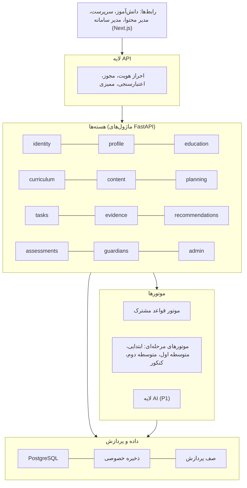
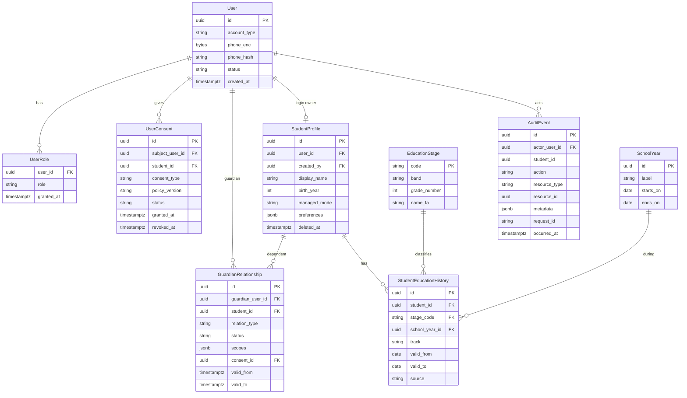
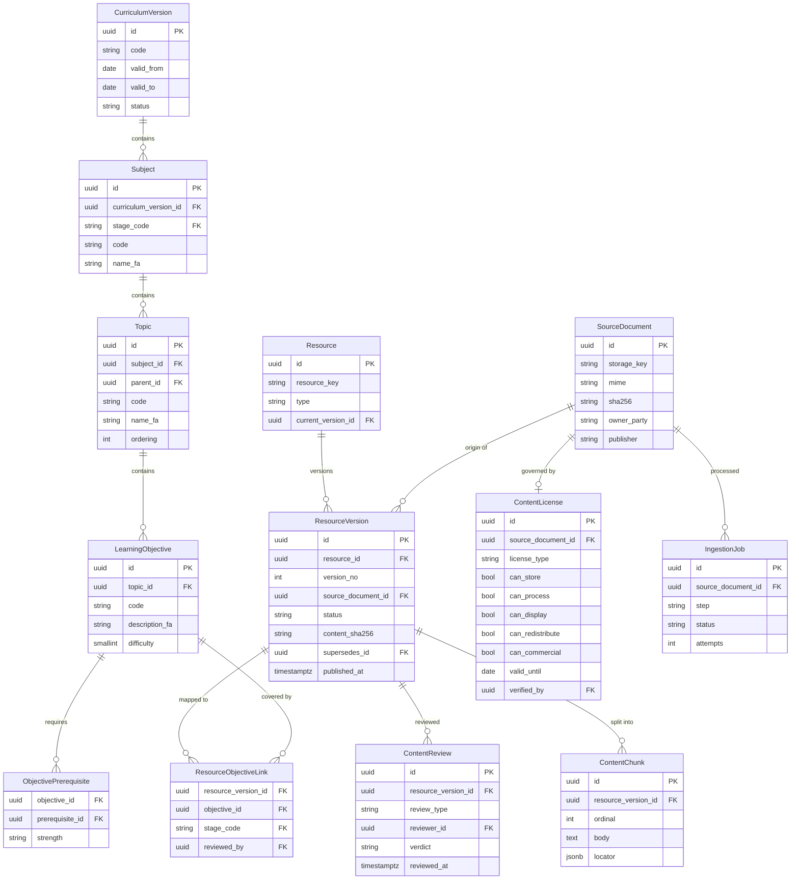
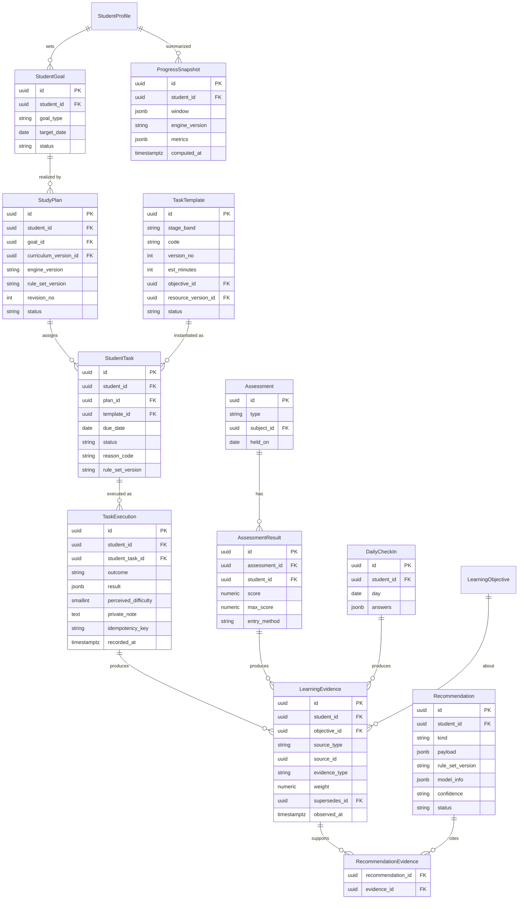
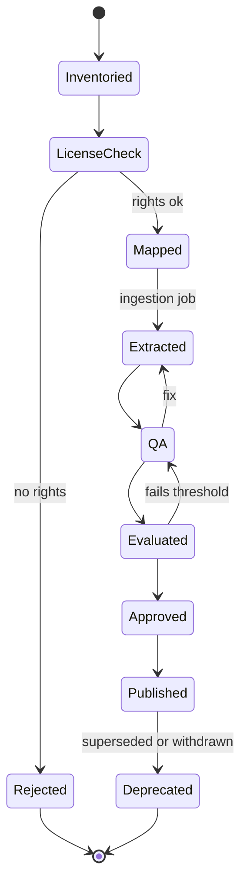
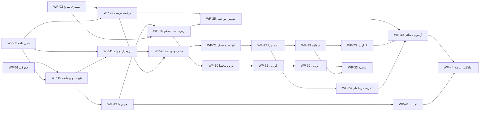

مشخصات قابل توسعه، بر پایه سند محصول نسخه ۳

# پلتفرم جامع یادگیری و هدایت تحصیلی

سه خروجی به ترتیب: ۱) PRD دقیق، ۲) طراحی فنی، ۳) برنامه اجرایی تیم. پنج گروه تحصیلی در سراسر سند با نقطه‌های رنگی نشان داده شده‌اند: ابتدایی ۱–۳ ابتدایی ۴–۶ متوسطه اول متوسطه دوم پشت‌کنکور

[خلاصه](#exec)[۱. PRD](#prd)[۲. طراحی فنی](#tech)[۳. برنامه اجرایی](#plan)[تصمیم‌های باز](#open)

## خلاصه و راهنمای خواندن

**برچسب‌ها.** قطعی مستقیماً از سند نسخه ۳؛ پیشنهاد تصمیمی که این مشخصات برای پر کردن شکاف پیشنهاد می‌کند و قابل تغییر است؛ باز مورد را سند عمداً باز گذاشته و فقط یک پیش‌فرض کاری برایش گذاشته‌ام. عددها (آستانه‌ها، نفر-روز، هفته) برآورد اولیه‌اند، نه تعهد مهندسی؛ سند هم برآورد ۱۰ تا ۱۲ هفته را مشروط اعلام کرده است.

**۵ گروه**همه از روز اول، با «حداقل تجربه» تعریف‌شده

**۴۰ نیازمندی**با اولویت و معیار پذیرش

**۳۹ بسته کار**در ۵ فاز و ۵ دروازه

**۴۴۶ از ۵۷۵**نفر-روز P0 در برابر ظرفیت تیم پایه

- **هسته P0 قاعده‌محور است.** در سند، هیچ‌کدام از اقلام P0 به مدل زبانی وابسته نیست. بازیابی و توصیه در P1 است. پس MVP بدون LLM هم ارزش قابل‌استفاده دارد.
- **مسیر بحرانی از دو جا شروع می‌شود:** بررسی حقوقی رضایت و سن‌بندی (WP-01) و ممیزی مجوز منابع (WP-02). اگر تا پایان هفته ۲ روشن نشوند، به‌ترتیب احراز هویت و مسیرهای آموزشی هر گروه عقب می‌افتند.
- **ظرفیت:** با تیم پایه ۱۲٫۸ نفر معادل تمام‌وقت، بار P0 حدود ۷۸٪ ظرفیت است و P1 بافر برنامه است. فاز ۲ حدود ۱۰۹٪ بار دارد و سرریزش باید در فاز ۳ جذب شود. روش و عددها در بخش ۳٫۳.
- **«همه پایه‌ها» یعنی کارت امتیاز شش‌معیاره برای هر گروه.** گروهی که رد شود، طبق سند عرضه را متوقف می‌کند، نه اینکه صرفاً در ظاهر پشتیبانی شود (بخش ۱٫۶).
- ۹ تصمیم باز با پیش‌فرض پیشنهادی، مالک و مهلت در بخش [تصمیم‌های باز](#open) آمده است.

## ۱. PRD دقیقنیازمندی‌ها، نقش‌ها، مسیرهای کاربر، محدوده هر گروه، معیار پذیرش، خارج از MVP

### ۱٫۱ هدف و اصول محصول

**هدف نسخه اولیه:** چرخه‌ای که در آن دانش‌آموز پروفایل و هدف تعریف می‌کند، تسک متناسب با پایه می‌گیرد، نتیجه و دشواری را ثبت می‌کند، بازخورد و گزارش می‌گیرد و مسیرش را بر اساس شواهد اصلاح می‌کند قطعی.

| اصل | پیامد برای طراحی |
| --- | --- |
| پشتیبانی واقعی از همه پایه‌ها، نه عمق برابر | پنج «حداقل تجربه» تعریف و آزموده می‌شود؛ قابلیت‌های تخصصی در موتورهای مرحله‌ای افزوده می‌شوند. |
| پلتفرم، نه ابزار کنکور | مدل داده و API به «کنکور» گره نمی‌خورد؛ کنکور یکی از موتورهای مرحله‌ای است. |
| ارزش قابل‌استفاده در عرضه اول | زیرساخت به‌تنهایی عرضه‌شدنی نیست؛ هر گروه باید چرخه کامل را طی کند. |
| شواهد جدا از نتیجه‌گیری | هر «ضعف» یا «توصیه» با شواهد، سطح اطمینان و نسخه قواعد قابل ردیابی است؛ برچسب قطعی به دانش‌آموز زده نمی‌شود. |
| مشارکت والد اختیاری، ایمنی اختیاری نیست | مشارکت والد پیش‌فرض اجباری نیست؛ رضایت، حفاظت از کودک و کنترل دسترسی در همه حال برقرارند. |
| منطق آموزشی نه در UI و نه در پرامپت | در موتور قواعد نسخه‌دار و قابل آزمون. |

### ۱٫۲ نقش‌ها و دسترسی‌ها

چهار رابط کاربری سند، به پنج نقش سامانه نگاشت می‌شود. «بازبین برنامه درسی» نقش پیشنهادی است، چون سند اعتبار آموزشی را مسئولیت جدا می‌داند پیشنهاد.

| نقش | کارهای اصلی | مرز دسترسی |
| --- | --- | --- |
| **دانش‌آموز** (۵ گروه) | پروفایل، هدف، تسک، ثبت نتیجه، گزارش. | فقط داده خودش. در سن‌بند پایین ممکن است حساب «سرپرست‌محور» باشد (بخش ۱٫۶). |
| **والد / سرپرست** P1 | رضایت، مشاهده خلاصه پیشرفت، در حالت سرپرست‌محور اقدام به‌نیابت. | فقط دانش‌آموزِ مرتبط و فقط طبق دامنه (scope) و رضایت فعال. یادداشت‌های خصوصی پیش‌فرض بسته است. |
| **مدیر محتوا** | فهرست‌برداری، ثبت مجوز، ورود، ارسال برای بازبینی، انتشار. | هیچ دسترسی به اطلاعات هویتی دانش‌آموز؛ فقط آمار تجمیعی. |
| **بازبین برنامه درسی** پیشنهاد | تأیید تطبیق آموزشی و تناسب سنی، تأیید ساختار هدف‌ها و الگوهای تسک. | مانند مدیر محتوا. |
| **مدیر سامانه** | کاربران و نقش‌ها، ممیزی، feature flag، گزارش پوشش. | محتوای آموزشی دانش‌آموز را به‌طور پیش‌فرض نمی‌بیند؛ فقط با «دسترسی اضطراری» با دلیل و ثبت ممیزی. |

### ۱٫۳ مسیرهای کاربر

| مسیر | گام‌ها | حالت‌های لبه | معیار موفقیت |
| --- | --- | --- | --- |
| **UJ-1 شروع** P0 | ورود یا ثبت‌نام ← ثبت رضایت‌های سن‌بند ← انتخاب پایه، سال تحصیلی (و رشته) ← چند پرسش کوتاه متناسب با گروه ← نمایش اولین تسک. | رضایت ناقص (دسترسی محدود تا تکمیل)؛ ناسازگاری سن و پایه (هشدار، نه مسدودسازی)؛ قطع میانه راه (ادامه از همان نقطه). | رسیدن به اولین تسک؛ هدف پیشنهادی ≤ ۳ دقیقه برای متوسطه و پشت‌کنکور. |
| **UJ-2 هدف و برنامه** P0 | انتخاب هدف و زمان در دسترس ← پیش‌نویس برنامه از قالب‌ها ← بازبینی و تأیید ← فعال‌شدن. | درسی که برای نسخه برنامه درسی محتوا ندارد (اعلام محدودیت، نه برنامه خالی). | برنامه فعال با نسخه موتور و قواعد. |
| **UJ-3 چرخه روزانه** P0 | دیدن تسک امروز ← انجام / عدم انجام / تعویق ← ثبت نتیجه و دشواری ← check-in ← بازخورد کوتاه. | ثبت بدون اینترنت (ارسال مجدد امن)؛ ثبت دیرهنگام؛ تسک منقضی‌شده. | هر اجرا دقیقاً یک بار و با شواهد ثبت می‌شود. |
| **UJ-4 گزارش و اصلاح** P0 | مشاهده گزارش هفتگی ← دیدن سطح کفایت داده ← انتخاب اصلاح (کاهش/افزایش بار، تغییر ترتیب) ← ثبت revision. | داده ناکافی (پیام «هنوز داده کافی نیست»). | گزارش فقط از شواهد ساخته می‌شود. |
| **UJ-5 ارتقای پایه** P0 | ثبت پایه یا سال جدید ← بستن بازه قبلی ← بازه جدید ← برنامه جدید با نسخه برنامه درسی جدید. | رشته‌گذاری در متوسطه دوم؛ برگشت اشتباه ثبت. | سوابق قبلی بازنویسی نمی‌شوند. |
| **UJ-6 ورود و انتشار منبع** P0 | فهرست‌برداری ← ثبت مجوز ← تطبیق با هدف‌ها ← استخراج ← QA ← ارزیابی ← تأیید دوگانه ← انتشار. | مجوز نامشخص (توقف)؛ مجوز منقضی (کنار گذاشتن خودکار). | هیچ منبع بدون مجوز و بازبینی در دسترس دانش‌آموز نیست. |
| **UJ-7 اتصال سرپرست** P1 | دعوت ← تأیید ← انتخاب دامنه دسترسی ← مشاهده خلاصه. | لغو دسترسی؛ چند سرپرست؛ دعوت منقضی. | سرپرست فقط آنچه scope اجازه می‌دهد می‌بیند. |
| **UJ-8 ثبت نتیجه آزمون** P1 | انتخاب آزمون ← ورود دستی نمره ← نمایش روند ساده. | نمره خارج از بازه؛ ثبت تکراری. | نتیجه با منبع ورود و سطح اطمینان ثبت می‌شود. |

### ۱٫۴ نیازمندی‌های عملکردی

هر نیازمندی باید دست‌کم یک سناریوی آزمون خودکار یا دستی داشته باشد (دروازه G0).

| شناسه | نیازمندی | اولویت | معیار پذیرش |
| --- | --- | --- | --- |
| هویت و رضایت |  |  |  |
| FR-A1 | ثبت‌نام و ورود با شماره موبایل و کد یک‌بارمصرف (روش نهایی باز) | P0 | کد پس از مدت پیکربندی‌شده باطل می‌شود؛ پس از N تلاش نادرست قفل موقت؛ توکن‌ها کوتاه‌عمر و چرخشی‌اند. |
| FR-A2 | ایجاد پروفایل دانش‌آموز توسط خودش یا سرپرست (حالت خودمدیر یا سرپرست‌محور) طبق سن‌بندی پیکربندی‌پذیر | P0 | رفتار هر سن‌بند از پیکربندی خوانده می‌شود نه از کد؛ آزمون برای هر پنج گروه. |
| FR-A3 | ثبت رضایت با نسخه متن، زمان و صاحب رضایت؛ امکان لغو | P0 | بدون رضایت لازم، قابلیت وابسته غیرفعال و پیام شفاف؛ لغو در یک گام اثر می‌کند و ممیزی می‌شود. |
| FR-A4 | درخواست حذف حساب و دریافت داده (فرایند ردیابی‌شده) | P0 | درخواست ثبت و پیگیری می‌شود؛ حذف نرم فوری؛ پاک‌سازی نهایی طبق سیاست نگهداری (باز). |
| پروفایل و پایه |  |  |  |
| FR-P1 | ثبت پایه، سال تحصیلی و برای متوسطه دوم و پشت‌کنکور رشته | P0 | گزینه‌ها از EducationStage و SchoolYear؛ ترکیب نامعتبر رد می‌شود. |
| FR-P2 | سابقه تحصیلی زمان‌مند و ارتقا بدون بازنویسی | P0 | پس از ارتقا دو بازه جدا وجود دارد؛ همپوشانی در پایگاه داده غیرممکن است؛ گزارش قبلی با ساختار همان زمان نمایش داده می‌شود. |
| FR-P3 | ترجیحات متناسب با گروه (زمان در دسترس، یادآوری، نمایش) | P0 | گزینه‌ها از پیکربندی گروه؛ ترجیحات در تخصیص تسک اثر می‌گذارند. |
| FR-P4 | مسیر شروع متناسب با هر گروه | P0 | هر پنج مسیر در آزمون E2E از ثبت‌نام تا اولین تسک می‌رسند. |
| هدف و برنامه |  |  |  |
| FR-L1 | ساخت هدف (یادگیری، امتحانی؛ آزمونی در P1) با تاریخ و درس‌ها | P0 | هدف به اهداف یادگیری نسخه فعال برنامه درسی متصل است. |
| FR-L2 | برنامه ساده بر پایه قالب و قواعد (بدون تولید خودکار بی‌نظارت) | P0 | هر برنامه engine_version و rule_set_version دارد؛ تا تأیید کاربر پیش‌نویس می‌ماند. |
| FR-L3 | ویرایش برنامه با نگهداری نسخه قبلی و ثبت دلیل | P0 | هر ویرایش revision جدید می‌سازد؛ برگشت ممکن است. |
| تسک |  |  |  |
| FR-T1 | الگوی تسک مرحله‌ای (نوع، مدت، دستورالعمل متناسب سن، هدف یادگیری، منبع) | P0 | هر الگو به مرحله، هدف و نسخه منبع متصل است؛ الگوی بازبینی‌نشده تخصیص نمی‌یابد. |
| FR-T2 | تخصیص تسک با قواعد قابل آزمون (پایه، هدف، زمان در دسترس، پیش‌نیاز) | P0 | هر تسک reason_code و rule_set_version دارد؛ آزمون golden برای هر گروه. |
| FR-T3 | ثبت انجام، عدم انجام، تعویق، نتیجه و دشواری درک‌شده | P0 | هر سه وضعیت ثبت‌پذیرند؛ فیلدهای اختیاری طبق قواعد گروه. |
| FR-T4 | ثبت امن در برابر تکرار و قطع شبکه | P0 | دو ارسال با یک Idempotency-Key فقط یک اجرا و یک مجموعه شواهد می‌سازد. |
| FR-T5 | check-in روزانه کوتاه | P0 | حداکثر ۳ پرسش پیشنهاد؛ برای ابتدایی ۱–۳ انتخاب تصویری. |
| بازخورد و گزارش |  |  |  |
| FR-R1 | بازخورد کوتاه پس از ثبت | P0 | از بانک بازخورد بازبینی‌شده و متناسب سن؛ بدون برچسب‌زنی. |
| FR-R2 | گزارش پیشرفت (هفتگی، و روزانه سبک) | P0 | فقط از LearningEvidence ساخته می‌شود. |
| FR-R3 | نمایش کفایت داده و اطمینان؛ بدون برچسب قطعی | P0 | «نیاز به تمرین» فقط با حداقل شاهد پیکربندی‌شده؛ وگرنه «داده کافی نیست». |
| FR-R4 | اصلاح مسیر بر پایه گزارش | P0 | از مسیر FR-L3 با دلیل ثبت می‌شود. |
| محتوا |  |  |  |
| FR-C1 | ثبت منبع با مالک، ناشر، پایه، درس و مبحث | P0 | فیلدهای اجباری؛ بدون پایه و درس قابل ارسال برای بازبینی نیست. |
| FR-C2 | ثبت مجوز و محدودیت‌های استفاده | P0 | منبع بدون ContentLicense تأییدشده قابل انتشار نیست (دروازه سخت). |
| FR-C3 | چرخه بازبینی و انتشار با ماشین حالت | P0 | انتقال غیرمجاز رد می‌شود؛ انتشار نیازمند دو تأیید مستقل (مجوز و آموزشی) پیشنهاد. |
| FR-C4 | نسخه‌بندی و ردیابی | P0 | نسخه منتشرشده تغییرناپذیر؛ تسک به resource_version_id ارجاع می‌دهد. |
| FR-C5 | حداقل یک مسیر آموزشی معتبر برای هر گروه | P0 | برای هر پنج گروه منتشرشده و تأییدشده توسط متخصص برنامه درسی. |
| FR-C6 | جست‌وجو و بازیابی با ارجاع | P1 | فقط نسخه‌های منتشرشده و مجازِ پردازش؛ هر نتیجه locator دارد. |
| FR-C7 | رفتار نبود منبع (پرسش تکمیلی یا اعلام محدودیت) | P1 | در مجموعه طلایی، پاسخ بدون منبع = ۰. |
| توصیه، سرپرست، آزمون |  |  |  |
| FR-N1 | توصیه با دلیل، شواهد و نسخه قواعد | P1 | ۱۰۰٪ توصیه‌ها به شواهد و rule_set_version لینک دارند. |
| FR-N2 | اعلام عدم قطعیت و امکان رد یا اصلاح توسط کاربر | P1 | رد کاربر ثبت می‌شود و بر تکرار توصیه اثر دارد. |
| FR-G1 | رابطه سرپرستی با دعوت و تأیید | P1 | فقط پس از تأیید فعال می‌شود؛ AuditEvent ثبت می‌شود. |
| FR-G2 | دامنه دسترسی دقیق و لغو فوری | P1 | هر endpoint scope لازم را در بک‌اند بررسی می‌کند. |
| FR-G3 | نمای خلاصه پیشرفت برای سرپرست | P1 | یادداشت‌ها و پیام‌های خصوصی پیش‌فرض نمایش داده نمی‌شوند. |
| FR-X1 | ورود دستی نتیجه آزمون و ارزیابی | P1 | اعتبارسنجی بازه نمره؛ روش ورود ثبت می‌شود. |
| FR-X2 | تحلیل ساده نتیجه (روند و مبحث) بدون OCR | P1 | همراه با سطح اطمینان. |
| مدیریت و سنجش |  |  |  |
| FR-M1 | مدیریت کاربران و نقش‌ها | P0 | هر تغییر نقش AuditEvent می‌سازد. |
| FR-M2 | مشاهده AuditEvent | P0 | جست‌وجو با عمل، کاربر، دانش‌آموز؛ غیرقابل ویرایش. |
| FR-M3 | feature flag به تفکیک گروه تحصیلی و قابلیت | P0 | روشن و خاموش‌کردن هر گروه بدون استقرار مجدد. |
| FR-M4 | گزارش پوشش و کارت امتیاز هر گروه | P0 | وضعیت شش معیار برای هر گروه. |
| FR-M5 | رویدادهای محصول و سنجه‌ها به تفکیک گروه | P0 | همه شاخص‌های بخش ۱۲ سند به تفکیک گروه محاسبه‌پذیرند. نرخ تکمیل تسک برای فرضیه «ماه رایگان» هم محاسبه می‌شود. |
| FR-S1 | لایه Entitlement (امکانات بر پایه مجوز اشتراک) بدون پرداخت | P1 | همه قابلیت‌ها از این لایه خوانده می‌شوند؛ پیش‌فرض: همه فعال. اشتراک بعداً بدون بازنویسی اضافه می‌شود. |

### ۱٫۵ محدوده هر گروه

ستون دوم از جدول سند (بخش ۳) گرفته شده و ستون‌های بعدی تفصیل پیشنهادی است. فهرست درس‌های MVP هر گروه را متخصص برنامه درسی در فاز صفر تعیین می‌کند؛ پیشنهاد: ۲ تا ۳ درس محوری برای هر گروه باز.

| گروه | حداقل تجربه (سند) قطعی | در محدوده P0 پیشنهاد | خارج از MVP | معیار پذیرش ویژه |
| --- | --- | --- | --- | --- |
| **ابتدایی ۱–۳** | پروفایل، فعالیت کوتاه، ثبت انجام، بازخورد ساده. | حساب سرپرست‌محور (طبق تصمیم حقوقی)؛ تسک‌های کوتاه (پیشنهاد ≤ ۱۵ دقیقه)؛ ثبت انجام با یک لمس؛ بازخورد تشویقی تصویری یا کوتاه؛ هدف لمس بزرگ؛ حداقل متن. | گزارش متنی؛ هر تحلیل ضعف؛ مقایسه با دیگران؛ چت آزاد. | در آزمون میدانی، اکثر کودکان با حداقل کمک بزرگسال تسک را شروع و ثبت می‌کنند (آستانه پیشنهادی ۸۰٪)؛ متن‌ها در سطح خوانایی پایه و تأییدشده توسط متخصص. |
| **ابتدایی ۴–۶** | هدف‌گذاری، تمرین، پیگیری، گزارش ساده. | انتخاب هدف از فهرست؛ تمرین و پیگیری؛ ثبت دشواری با ۳ گزینه؛ گزارش ساده با نوار پیشرفت؛ استقلال تدریجی. | تشخیص خودکار مبحث نیازمند تمرین (قابلیت توسعه)؛ رتبه‌بندی. | دانش‌آموز بدون کمک هدف را انتخاب و تسک را ثبت می‌کند؛ گزارش را درست توضیح می‌دهد (مشاهده‌ای). |
| **متوسطه اول** | برنامه، تسک، ارزیابی، گزارش پیشرفت. | برنامه هفتگی؛ تسک؛ ارزیابی کوتاه؛ گزارش پیشرفت؛ جمع‌آوری شواهد مبحثی برای تحلیل آینده. | پیشنهاد مسیر رشته و هدایت تحصیلی خودکار؛ تحلیل مبحثی پیشرفته (در MVP فقط داده جمع می‌شود). | برنامه هفتگی را بسازد و یک هفته چرخه را کامل کند؛ گزارش شامل سطح کفایت داده است. |
| **متوسطه دوم** | پیگیری درس‌ها، هدف‌های امتحانی، ثبت عملکرد. | چند درس هم‌زمان؛ تاریخ امتحان (تقویم جلالی)؛ ثبت نمره و عملکرد؛ برنامه مبتنی بر تاریخ امتحان؛ رشته. | تحلیل پیشرفته مباحث؛ برنامه‌ریزی آزمون پیچیده؛ OCR. | با تاریخ امتحان، برنامه معتبر ساخته می‌شود؛ ثبت عملکرد در گزارش دیده می‌شود. |
| **پشت‌کنکور** | برنامه، تسک، ثبت نتایج، بررسی روند. | برنامه و تسک؛ ثبت دستی نتایج؛ نمودار روند ساده؛ مرور ساده (قاعده‌محور). | OCR کارنامه، تحلیل مؤسسات، موتور کنکور پیشرفته (P2). | روند نتایج ثبت‌شده با سطح کفایت داده نمایش داده می‌شود؛ هیچ ادعای کارنامه‌محور بدون داده ورودی نیست. |

### ۱٫۶ معیار پذیرش «مرحله پشتیبانی‌شده» و حالت سرپرست‌محور

شش معیار سند، به‌صورت چک‌لیست آزمون‌پذیر. نتیجه برای هر گروه در «کارت امتیاز» ثبت می‌شود (FR-M4).

| معیار سند | روش راستی‌آزمایی | شاهد لازم |
| --- | --- | --- |
| مسیر شروع و پروفایل متناسب | E2E خودکار UJ-1 برای گروه | گزارش اجرای آزمون |
| دست‌کم یک مسیر آموزشی قابل‌استفاده | وجود نسخه منتشرشده و تأییدشده (FR-C5) | شناسه نسخه و تأیید بازبین |
| تسک‌ها از قواعد و محتوای همان مرحله پیروی می‌کنند | آزمون golden موتور قواعد + بازبینی نمونه‌ای توسط متخصص | گزارش golden و برگه بازبینی |
| ثبت نتیجه و دریافت گزارش مرتبط | E2E خودکار UJ-3 و UJ-4 | گزارش اجرای آزمون |
| سازگاری تجربه با سن و استقلال گروه | آزمون میدانی با کاربران همان گروه (WP-40) | خلاصه مشاهدات و نرخ موفقیت |
| خطاها و محدودیت‌ها در آزمون بررسی شده‌اند | فهرست محدودیت‌های شناخته‌شده + سناریوهای خطا (≥ ۳ مورد برای هر گروه) | فهرست محدودیت‌ها |

```
Feature: Core loop for a supported stage (per stage group)
  Scenario: Student records a task result and receives a report
    Given a student in stage group "G07" with an active plan
    And a published resource version approved for that stage
    When the student records outcome "done" with perceived_difficulty 3
    Then exactly one TaskExecution exists for the Idempotency-Key
    And LearningEvidence rows are created and linked to the execution
    And the weekly report shows data_sufficiency in ("insufficient","partial","sufficient")
    And no label like "weak in topic" appears when evidence_count < min_required
```

**حالت سرپرست‌محور باز.** سند مشارکت والد را اختیاری می‌داند اما حذف الزامات قانونی و رضایت را مجاز نمی‌کند. برای سن‌بندهای پایین، دانش‌آموز احتمالاً حساب مستقل ندارد. پیش‌فرض محافظه‌کارانه پیشنهادی: برای زیر آستانه‌ای که مشاور حقوقی تعیین می‌کند، رضایت سرپرست هنگام ثبت‌نام ثبت شود و حساب «سرپرست‌محور» باشد؛ این رضایتِ یک‌بار است و به معنای مشارکت مداوم والد نیست. رفتار هر سن‌بند در جدول `age_policies` نگهداری می‌شود تا تصمیم نهایی بدون تغییر کد اعمال شود.

**اگر گروهی کارت امتیاز را رد کند:** پیش‌فرض سند این است که زمان‌بندی یا پیچیدگی بازنگری شود، نه پشتیبانی ظاهری. عرضه تدریجی (فعال‌سازی گروه‌ها با flag) فقط با تصمیم صریح مدیر محصول در دفتر تصمیم‌ها مجاز است.

### ۱٫۷ الزامات غیرعملکردی

| حوزه | الزام | آستانه پیشنهاد |
| --- | --- | --- |
| امنیت | TLS همه‌جا؛ رمزنگاری داده در حالت ذخیره؛ مجوز در بک‌اند با رد پیش‌فرض (deny-by-default)؛ مدیریت راز؛ نبود PII در لاگ. | زیرمجموعه OWASP ASVS سطح ۲؛ صفر یافته بحرانی باز در G4. |
| حریم خصوصی کودک | حداقل‌گرایی داده (مثلاً سال تولد به‌جای تاریخ کامل)؛ جداسازی نقش‌ها؛ بدون ردیاب شخص ثالث در رابط دانش‌آموز؛ ارسال داده به ارائه‌دهنده AI بیرونی فقط پس از ارزیابی حریم خصوصی و حذف شناسه‌ها. | بازبینی مشاور حریم خصوصی پیش از G4. |
| عملکرد | زمان پاسخ API و بارگذاری صفحه. | p95 خواندن ≤ ۵۰۰ms؛ نوشتن ≤ ۸۰۰ms؛ LCP ≤ ۳ ثانیه روی ۴G متوسط. |
| پایداری | دسترس‌پذیری و بازیابی. | ۹۹٫۵٪ ماهانه؛ RPO ≤ ۲۴ ساعت؛ RTO ≤ ۴ ساعت؛ یک تمرین بازیابی پیش از عرضه. |
| سازگاری | موبایل‌اول، راست‌به‌چپ، تقویم جلالی (کبیسه و اسفند)، ارقام فارسی و لاتین در ورودی، تحمل شبکه ضعیف برای ثبت اجرا. | آزمون تاریخ جلالی و نرمال‌سازی ارقام در CI. |
| دسترس‌پذیری رابط | خوانایی، کنتراست، پیمایش با کیبورد. | WCAG 2.1 AA از متوسطه اول به بالا؛ برای ابتدایی هدف لمس ≥ ۴۸px. |
| اتکا به AI | هیچ مسیر P0 به LLM وابسته نیست؛ خطای ارائه‌دهنده یعنی بازگشت به رفتار قاعده‌محور. | آزمون خاموش‌بودن AI در CI. |
| هزینه | ثبت هزینه هر عملیات AI و به ازای کاربر فعال. | سقف: باز (بودجه نامعلوم). |
| نگهداری‌پذیری | پوشش آزمون ماژول‌های قواعد و مجوز. | ≥ ۸۵٪ و ۱۰۰٪ شاخه‌های قواعد با golden. |

### ۱٫۸ خارج از MVP

| مورد | اولویت | شرط بازگشت به دامنه |
| --- | --- | --- |
| OCR گسترده انواع کارنامه | P2 | مشخص‌شدن مؤسسات و مجوز داده، و نیاز واقعی از میدان. |
| موتور تخصصی پیشرفته کنکور؛ تحلیل عمیق روند | P2 | داده کافی از ثبت دستی و اعتبارسنجی ارزش. |
| تولید برنامه‌های پیچیده و بلندمدت | P2 | قواعد v1 پایدار و ارزیابی کیفیت قابل‌قبول. |
| داشبورد مؤسسات و مدارس | P2 | مدل داده چندمستأجری و حقوق داده. |
| اپلیکیشن بومی | P2 | وب‌اپ کافی نبودن (سند). |
| پرداخت، صورتحساب، تمدید و تخفیف | خارج از MVP | تصمیم قیمت و آزمون تمایل به پرداخت (بخش ۱۰ سند). |
| چت‌بات عمومی؛ تولید برنامه بدون نظارت؛ برچسب‌زدن قطعی؛ میکروسرویس‌سازی زودهنگام | خارج از مرز محصول | مرز محصول سند؛ فقط با تغییر تصمیم قطعی. |
| پیشنهاد رشته و هدایت تحصیلی خودکار؛ مقایسه و رتبه‌بندی بین دانش‌آموزان | خارج از MVP پیشنهاد | داده، ارزیابی و بررسی اخلاقی و حقوقی. |
| شخصی‌سازی عمیق با LLM | وابسته به تصمیم باز ۷ | پیش‌فرض: خارج از MVP. |

### ۱٫۹ تصمیم‌های باز، پیش‌فرض کاری و مهلت

هفت مورد اول همان فهرست بخش ۱۳ سند است. دو مورد پایانی از تفکیک نیازمندی‌ها پیدا شد. ستون «پیش‌فرض» فقط برای ادامه کار است و تا تصمیم مالک، قطعی نیست.

| # | موضوع | پیش‌فرض کاری پیشنهاد | اثر اگر دیر شود | مالک | مهلت |
| --- | --- | --- | --- | --- | --- |
| ۱ | جزئیات نظام آموزشی ایران و نسخه برنامه درسی | یک CurriculumVersion فعال برای سال تحصیلی جاری؛ ساختار آماده نسخه‌های بعدی. | WP-12 و WP-25 متوقف. | متخصص برنامه درسی | پایان هفته ۲ |
| ۲ | منابع موجود، مالکیت و مجوز | فقط منابعی که مجوز پردازش و نمایش دارند وارد شوند. | مسیر آموزشی بعضی گروه‌ها ناقص. | مسئول محتوا + مشاور | پایان هفته ۲ |
| ۳ | دامنه کنکور و آزمون‌ها | ورود دستی نتیجه؛ بدون OCR؛ مؤسسات بعد از MVP. | P1 آزمون و بخشی از گروه پشت‌کنکور. | مدیر محصول | پایان هفته ۴ |
| ۴ | نقش سرپرست و زیر سن قانونی | رضایت سرپرست برای زیر آستانه؛ حساب سرپرست‌محور برای سن‌بند پایین؛ یادداشت‌ها برای سرپرست پیش‌فرض بسته. | WP-10 و WP-13 متوقف؛ ریسک حقوقی. | مشاور حریم خصوصی | پایان هفته ۲ |
| ۵ | تیم، بودجه، زیرساخت و محل میزبانی | تیم پایه بخش ۳٫۱؛ میزبانی تا تصمیم، مبتنی بر Docker قابل‌انتقال. | برنامه ۱۲ هفته‌ای نامعتبر. | مدیر محصول | پایان هفته ۱ |
| ۶ | قیمت و بسته‌های اشتراک | MVP بدون پرداخت؛ لایه Entitlement؛ آزمون تمایل به پرداخت از هفته ۸. | نقش در G4 ندارد؛ بر نقشه پس از MVP اثر دارد. | مدیر محصول | هفته ۸ |
| ۷ | محدوده شخصی‌سازی | P0 قاعده‌محور؛ LLM فقط در P1 با بازیابی از منابع تأییدشده و بدون تصمیم مستقل. | دامنه فاز ۳ مبهم. | مدیر محصول + رهبر فنی | پایان هفته ۴ |
| ۸ | فرضیه «ماه اول رایگان، ماه دوم رایگان با تکمیل بیش از ۸۰٪ تسک» | به‌عنوان فرضیه تجاری جدا ثبت می‌شود؛ MVP فقط نرخ تکمیل را اندازه می‌گیرد. | — | مدیر محصول | هفته ۸ |
| ۹ | روش احراز هویت (موبایل و OTP یا غیر آن) | موبایل و OTP؛ برای سرپرست‌محور، شماره سرپرست. | WP-10 تأخیر. | رهبر فنی + مشاور | پایان هفته ۲ |

## ۲. طراحی فنیمعماری ماژولار، ERD، قراردادهای API، مجوزها، ورود و نسخه‌بندی محتوا

### ۲٫۱ تصمیم‌های معماری

| کد | تصمیم | دلیل |
| --- | --- | --- |
| ADR-1 | مونولیت ماژولار؛ نه میکروسرویس. جداسازی با مرز ماژول و قرارداد سرویس. | سند میکروسرویس زودهنگام را خارج مرز می‌داند؛ تیم و بار کم است. |
| ADR-2 | Next.js و TypeScript برای وب‌اپ؛ FastAPI و Python برای API؛ PostgreSQL. | گزینه‌های اولیه سند؛ تطبیق با مهارت تیم و میزبانی در G0 باز. |
| ADR-3 | مجوزدهی در بک‌اند با یک لایه سیاست مرکزی و رد پیش‌فرض. | قاعده صریح سند: پنهان‌کردن عنصر UI کافی نیست. |
| ADR-4 | منطق آموزشی فقط در موتور قواعد نسخه‌دار و موتورهای مرحله‌ای؛ نه UI، نه پرامپت. | آزمون‌پذیری و ردیابی. |
| ADR-5 | داده تاریخی زمان‌مند و شواهد append-only. | ارتقای پایه و تغییر برنامه درسی نباید گذشته را بازنویسی کند. |
| ADR-6 | لایه انتزاعی ارائه‌دهنده مدل؛ هیچ مسیر P0 به آن وابسته نیست. | ریسک وابستگی به یک ارائه‌دهنده و هزینه. |
| ADR-7 | بازیابی: ابتدا جست‌وجوی ساختاریافته (فیلتر مرحله، درس، هدف + متن کامل)؛ pgvector فقط اگر ارزیابی نیاز را ثابت کند. | سند همین ترتیب را پیشنهاد می‌دهد. |
| ADR-8 | هر جدول داده دانش‌آموز ستون `student_id` دارد (غیرنرمال‌شده عمداً). | فیلتر یکنواخت مجوز، و امکان Row-Level Security به‌عنوان لایه دوم. |

### ۲٫۲ ساختار ماژول‌ها



| ماژول | مسئولیت | موجودیت‌ها | وابستگی مجاز |
| --- | --- | --- | --- |
| identity | حساب، OTP، نشست، رضایت، نقش | User, UserRole, UserConsent | — |
| profile / education | پروفایل، پایه، سابقه زمان‌مند | StudentProfile, EducationStage, SchoolYear, StudentEducationHistory | identity |
| guardians | رابطه سرپرستی، scope، رضایت مرتبط | GuardianRelationship | identity, profile |
| curriculum | نسخه برنامه درسی، درس، مبحث، هدف، پیش‌نیاز | CurriculumVersion, Subject, Topic, LearningObjective, ObjectivePrerequisite | education |
| content | منبع، مجوز، بازبینی، ورود، نسخه | Resource, ResourceVersion, SourceDocument, ContentLicense, ContentReview, IngestionJob | curriculum |
| planning | هدف و برنامه | StudentGoal, StudyPlan | profile, curriculum, rules |
| tasks | الگو، تخصیص، اجرا، check-in | TaskTemplate, StudentTask, TaskExecution, DailyCheckIn | planning, content, evidence (فقط نوشتن) |
| evidence | شواهد، محاسبه پیشرفت | LearningEvidence, ProgressSnapshot | curriculum |
| assessments | آزمون و نتیجه (P1) | Assessment, AssessmentResult | curriculum, evidence |
| recommendations | توصیه با دلیل (P1) | Recommendation, RecommendationEvidence | evidence, rules, ai |
| admin / audit | ممیزی، flag، گزارش پوشش | AuditEvent, FeatureFlag, Entitlement | همه (فقط خواندن) |

**قواعد وابستگی:** ماژول‌ها فقط از طریق رابط سرویس هم‌دیگر را صدا می‌زنند؛ دسترسی مستقیم به جدول ماژول دیگر ممنوع است و در CI با ابزار کنترل import (مثل import-linter) اجرا می‌شود. وابستگی دوری ممنوع است.

ساختار مخزن و رابط موتور مرحله‌ای

```
/apps/web                 Next.js + TypeScript (client generated from OpenAPI)
/services/api
  app/core/               config, db, security, audit, errors, flags
  app/modules/{identity,profile,education,guardians,curriculum,content,
               planning,tasks,evidence,assessments,recommendations,admin}/
      api.py  schemas.py  service.py  policy.py  repo.py  models.py  events.py  tests/
  app/engines/            rules/  primary_low/  primary_high/  lower_secondary/
                          upper_secondary/  konkur/
  app/ai/                 provider.py  prompts/  eval/  metering.py
  app/workers/            ingestion.py  snapshots.py  license_expiry.py
  migrations/
/packages/contracts       OpenAPI + generated types

# app/engines/base.py
class StageEngine(Protocol):
    stage_codes: set[str]
    version: str
    def generate_task_candidates(self, ctx: PlanContext) -> list[TaskCandidate]: ...
    def derive_evidence(self, ctx: PlanContext, execution: Execution) -> list[EvidenceInput]: ...
    def build_report(self, ctx: PlanContext, window: DateWindow) -> ReportSections: ...
```

موتورها فقط توابع خالص و بدون I/O هستند؛ ثبت‌نام از طریق registry و بر پایه stage_code و نسخه. افزودن موتور جدید بدون تغییر هسته انجام می‌شود.

### ۲٫۳ ERD پایگاه داده

موجودیت‌های سند حفظ شده‌اند. موجودیت‌های افزوده‌شده پیشنهاد: `UserRole`، `StudentGoal`، `ResourceVersion`، `ResourceObjectiveLink`، `IngestionJob`، `ContentChunk`، `ProgressSnapshot`، `RecommendationEvidence`، `FeatureFlag`، `Entitlement`، `IdempotencyKey`، `OutboxEvent`. دلیل هر کدام: ردیابی نسخه، جدا نگه‌داشتن شواهد از نتیجه، و پشتیبانی از ویژگی‌های سند.

#### الف) هویت، پایه و دسترسی



#### ب) ساختار آموزشی و محتوا



#### ج) برنامه، فعالیت و شواهد



قواعد داده، قیدها و ایندکس‌ها

| قاعده | پیاده‌سازی |
| --- | --- |
| سابقه زمان‌مند بدون همپوشانی | قید exclusion با `daterange(valid_from, valid_to)` برای هر `student_id` (افزونه btree_gist)؛ ارتقا در یک تراکنش بازه قبلی را می‌بندد و بازه جدید می‌گشاید. |
| شواهد تغییرناپذیر | LearningEvidence و TaskExecution فقط INSERT؛ تریگر UPDATE/DELETE را رد می‌کند. اصلاح = ردیف جدید با `supersedes_id`. |
| نسخه منتشرشده تغییرناپذیر | تریگر روی ResourceVersion: پس از `published` فقط انتقال به `deprecated` مجاز است. |
| دروازه مجوز | تریگر یا قید در سطح سرویس: انتقال به `published` نیازمند ContentLicense با `can_process` و `can_display` و `verified_by` غیرتهی و دو ContentReview از انواع license و curriculum با بازبین‌های متفاوت. |
| Idempotency | جدول IdempotencyKey با `(student_id, key)` یکتا؛ ذخیره خلاصه درخواست و پاسخ؛ کلید با بدنه متفاوت = خطای ۴۲۲. |
| حریم خصوصی | شماره موبایل به‌صورت رمزشده برای ارسال OTP و هش برای جست‌وجو؛ `birth_year` به‌جای تاریخ کامل؛ حذف نرم و job پاک‌سازی؛ `private_note` جدا از شواهد و در گزارش‌ها استفاده نمی‌شود. |
| ایندکس‌ها | `(student_id, due_date)` روی StudentTask؛ `(student_id, observed_at)` و `(objective_id, observed_at)` روی LearningEvidence؛ GIST روی بازه سابقه؛ ایندکس جزئی روی `status='published'`؛ GIN متن کامل روی ContentChunk (P1). |
| رویداد دامنه | جدول OutboxEvent در همان تراکنش نوشته می‌شود و worker آن را به صف می‌دهد (برای ساخت شواهد، snapshot، ممیزی). |
| تقویم | تاریخ‌ها در پایگاه داده میلادی (UTC و date)؛ تبدیل جلالی فقط در لایه نمایش؛ مرز سال تحصیلی در SchoolYear. |

### ۲٫۴ قراردادهای API

| موضوع | قرارداد |
| --- | --- |
| پایه | `/api/v1`؛ JSON؛ شناسه UUID؛ زمان ISO-8601 در UTC؛ OpenAPI منبع حقیقت و تولید خودکار کلاینت TypeScript. |
| احراز هویت | توکن دسترسی کوتاه‌عمر (پیشنهاد ۱۵ دقیقه) و refresh چرخشی در کوکی httpOnly برای وب. |
| محدوده دانش‌آموز | همه منابع دانش‌آموز زیر `/students/{student_id}/…`؛ مجوز براساس رابطه بازیگر و دانش‌آموز. |
| خطا | RFC 9457 (`application/problem+json`) با `code` ماشین‌خوان و `request_id`. |
| صفحه‌بندی | مبتنی بر cursor: `?limit=&cursor=`. |
| تکرار امن | هدر `Idempotency-Key` روی ثبت اجرا، رضایت، و ایجاد برنامه. |
| هم‌زمانی | ویرایش برنامه با `If-Match` و ETag؛ ناسازگاری = ۴۱۲. |
| نسخه‌بندی | تغییر سازگار = افزودن فیلد اختیاری؛ تغییر ناسازگار = `/v2`؛ آزمون قرارداد در CI. |
| نرخ | محدودیت نرخ روی OTP و ورود؛ هدرهای `RateLimit-*`. |

#### فهرست endpointها

| روش و مسیر | دسترسی | اولویت |
| --- | --- | --- |
| حساب و رضایت |  |  |
| `POST /auth/otp/request` · `POST /auth/otp/verify` | عمومی با محدودیت نرخ | P0 |
| `POST /auth/refresh` · `POST /auth/logout` · `GET /me` | کاربر احرازشده | P0 |
| `POST /consents` · `GET /students/{id}/consents` · `PATCH /consents/{id}` (لغو) | صاحب رضایت طبق سن‌بند | P0 |
| `POST /me/data-requests` (حذف، دریافت) | کاربر | P0 |
| دانش‌آموز، پایه و برنامه درسی |  |  |
| `POST /students` · `GET, PATCH /students/{id}` | خود دانش‌آموز، یا سرپرست با scope | P0 |
| `GET, POST /students/{id}/education-history` | خود دانش‌آموز، یا سرپرست با scope | P0 |
| `GET /education-stages` · `GET /school-years` | کاربر احرازشده | P0 |
| `GET /curriculum/versions` · `…/subjects` · `…/topics` · `…/objectives` | کاربر احرازشده (خواندن) | P0 |
| `POST, PATCH /curriculum/…` | مدیر محتوا (ویرایش)، بازبین (تأیید) | P0 |
| هدف، برنامه، تسک، گزارش |  |  |
| `GET, POST /students/{id}/goals` | دانش‌آموز، یا سرپرست با scope | P0 |
| `POST /students/{id}/plans` (پیش‌نویس از هدف) · `PATCH /plans/{id}` (If-Match) · `POST /plans/{id}/activate` | دانش‌آموز، یا سرپرست با scope | P0 |
| `GET /students/{id}/tasks?date=&status=` | دانش‌آموز، یا سرپرست با `tasks.read` | P0 |
| `POST /students/{id}/tasks/{task_id}/executions` (Idempotency-Key) | دانش‌آموز، یا سرپرست در حالت سرپرست‌محور | P0 |
| `POST, GET /students/{id}/check-ins` | دانش‌آموز؛ خواندن سرپرست طبق scope | P0 |
| `GET /students/{id}/reports/progress?window=week` | دانش‌آموز، یا سرپرست با `reports.read` | P0 |
| توصیه، آزمون، سرپرست |  |  |
| `GET /students/{id}/recommendations` · `POST /recommendations/{id}/respond` | دانش‌آموز، یا سرپرست طبق scope | P1 |
| `POST, GET /students/{id}/assessment-results` | دانش‌آموز، یا سرپرست با scope | P1 |
| `POST /students/{id}/guardian-invitations` · `POST /guardian-invitations/{token}/accept` · `PATCH, DELETE /guardianships/{id}` · `GET /guardians/me/students` | دانش‌آموز یا سرپرست طبق سن‌بند | P1 |
| محتوا |  |  |
| `POST /content/source-documents` (آدرس آپلود امضاشده) · `POST /content/resources` · `POST /content/resources/{id}/versions` | مدیر محتوا | P0 |
| `POST /content/versions/{id}/transitions` · `POST, GET /content/versions/{id}/reviews` · `GET /content/inventory` | مدیر محتوا؛ بازبین برای انواع آموزشی و کیفیت | P0 |
| `POST /retrieval/search` | دانش‌آموز (بافت مرحله) | P1 |
| مدیریت |  |  |
| `GET /admin/users` · `PATCH /admin/users/{id}/roles` · `GET /admin/audit-events` · `PUT /admin/feature-flags/{key}` · `GET /admin/coverage-report` | مدیر سامانه | P0 |
| `POST /admin/break-glass` (دلیل اجباری) | مدیر سامانه | P0 |

نمونه درخواست و پاسخ (JSON)

#### ارتقای پایه

```
POST /api/v1/students/6f1c…/education-history
{ "stage_code": "G07", "school_year_id": "b2a9…", "track": null, "effective_from": "2026-09-23" }

201 Created
{ "id": "c0de…", "stage_code": "G07", "valid_from": "2026-09-23", "valid_to": null,
  "closed_previous": { "id": "ab12…", "stage_code": "G06", "valid_to": "2026-09-22" } }
```

#### ثبت اجرای تسک (امن در برابر تکرار)

```
POST /api/v1/students/6f1c…/tasks/9d3e…/executions
Idempotency-Key: 0b9f2c1e-…
{ "outcome": "done", "result": { "correct": 7, "total": 10 },
  "perceived_difficulty": 3, "client_ts": "2026-10-13T16:20:00Z" }

201 Created
{ "id": "e7a1…", "task_status": "done", "evidence_created": 2 }

# same key, same body again
200 OK   Idempotent-Replay: true   (same body, no new rows)
# same key, different body
422      { "code": "IDEMPOTENCY_KEY_REUSED" }
```

#### گزارش پیشرفت با کفایت داده

```
GET /api/v1/students/6f1c…/reports/progress?window=week
200 OK
{ "window": { "from": "2026-10-10", "to": "2026-10-16" },
  "engine_version": "primary_high@1.2.0", "rule_set_version": "rs-2026.10.1",
  "data_sufficiency": "partial",
  "sections": [
    { "type": "completion", "value": { "assigned": 14, "done": 9, "skipped": 3, "postponed": 2 } },
    { "type": "topic_signal", "topic_id": "4b7c…", "signal": null, "confidence": "low",
      "evidence_count": 3, "min_required": 5, "explain_code": "INSUFFICIENT_EVIDENCE" } ] }
```

#### خطای مجوز

```
403 Forbidden  (application/problem+json)
{ "type": "https://example.invalid/problems/forbidden", "title": "Forbidden", "status": 403,
  "code": "GUARDIAN_SCOPE_MISSING", "detail": "Scope reports.read is required.",
  "request_id": "req_8f2a…" }
```

#### بازیابی (P1): با منبع و بدون منبع

```
POST /api/v1/retrieval/search   { "student_id": "6f1c…", "query": "…", "limit": 5 }

200 { "status": "ok", "results": [
  { "resource_version_id": "77aa…", "locator": { "page": 42 }, "snippet": "…", "score": 0.81 } ] }

200 { "status": "no_source", "message_code": "NO_APPROVED_SOURCE",
      "follow_up": { "type": "clarify", "options": ["pick_topic", "pick_stage"] } }
```

### ۲٫۵ مجوزها

**مدل:** نقش‌ها (RBAC) برای کارکنان، و دسترسی مبتنی بر رابطه برای داده دانش‌آموز. یک تابع مرکزی `can(actor, action, resource)` تنها نقطه تصمیم است.

- **دانش‌آموز:** فقط `student_id` خودش. برای پروفایل سرپرست‌محور، سرپرست به‌نیابت عمل می‌کند و این در ممیزی ثبت می‌شود.
- **سرپرست:** فقط وقتی GuardianRelationship در وضعیت active باشد، رضایت معتبر باشد، بازه `valid_from…valid_to` بگذرد و scope عمل را شامل شود. scopeها: `profile.read, profile.write, plan.read, plan.write, tasks.read, reports.read, checkin.read, notes.read, consent.manage`. پیش‌فرض P1: `profile.read, plan.read, tasks.read, reports.read`؛ `notes.read` بسته.
- **مدیر محتوا و بازبین:** هیچ endpoint دانش‌آموزی؛ فقط آمار تجمیعی ناشناس.
- **مدیر سامانه:** کاربران، نقش‌ها، ممیزی، flag؛ دسترسی به داده آموزشی فقط با `break-glass` با دلیل مکتوب، مدت‌دار و ممیزی‌شده پیشنهاد.

| عمل | دانش‌آموز | سرپرست | مدیر محتوا | بازبین | مدیر سامانه |
| --- | --- | --- | --- | --- | --- |
| پروفایل خود | ✓ خود | scope | — | — | فقط حساب |
| برنامه و تسک | ✓ خود | scope | — | — | — |
| ثبت اجرا و check-in | ✓ خود | فقط سرپرست‌محور | — | — | — |
| گزارش پیشرفت | ✓ خود | scope | تجمیعی | تجمیعی | تجمیعی |
| یادداشت خصوصی | ✓ خود | پیش‌فرض ✗؛ نیازمند scope و شرط سن‌بند باز | — | — | — |
| مدیریت رضایت | طبق سن‌بند | ✓ | — | — | — |
| ایجاد و ویرایش منبع | — | — | ✓ | پیشنهاد اصلاح | — |
| تأیید مجوز و انتشار | — | — | ✓ (مجوز) | ✓ (آموزشی) | — |
| ساختار برنامه درسی | خواندن | خواندن | ویرایش | تأیید | — |
| کاربران، نقش‌ها، ممیزی، flag | — | — | — | — | ✓ |

**اجرا:**

- هر route با `require(Action.X)` اعلام می‌شود؛ route بدون اعلام، آزمون CI را رد می‌کند (deny-by-default).
- مخزن‌ها همیشه با `student_id` فیلتر می‌کنند. Row-Level Security در PostgreSQL لایه دوم است P1.
- آزمون ماتریسی خودکار: هر route × هر نقش × (دانش‌آموز خود، دانش‌آموز دیگر، سرپرست با scope، سرپرست لغوشده، رضایت منقضی). هیچ شکستی پذیرفته نیست.
- ممیزی می‌شوند: ورود، تغییر رضایت، اتصال یا لغو سرپرست، خواندن یادداشت خصوصی توسط سرپرست، break-glass، حذف و دریافت داده، انتشار منبع، تغییر نقش.
- رفتار سن‌بندها از جدول `age_policies` می‌آید: نیاز رضایت سرپرست، اجازه ورود مستقل، پیش‌فرض نمایش یادداشت. مقادیر باز.

### ۲٫۶ موتور قواعد، شواهد و لایه AI

- **موتور قواعد:** توابع خالص با ورودی صریح (پروفایل، برنامه، شواهد، پیکربندی گروه) و خروجی قابل ردیابی. هر خروجی `rule_set_version` و `reason_code` دارد. قواعد به‌صورت داده نسخه‌دار نگهداری می‌شوند؛ تغییر قاعده = نسخه جدید، بدون بازنویسی گذشته.
- **خط لوله شواهد ← نتیجه:** رویداد اجرا ← `derive_evidence` ← LearningEvidence (خام، تغییرناپذیر) ← محاسبه ProgressSnapshot (قابل بازسازی). «ضعف» فقط وقتی اعلام می‌شود که حداقل شاهد (`min_evidence`)، حداقل پراکندگی زمانی و سطح اطمینان از پیکربندی رعایت شود؛ مقادیر اولیه (مثلاً ۵ شاهد در ≥ ۳ روز) باید با متخصص برنامه درسی تنظیم شوند باز. خروجی همواره قابل اصلاح است.
- **لایه AI (P1):** رابط `complete(prompt_id, inputs) → structured` پشت یک لایه انتزاعی؛ پرامپت‌ها در رجیستری نسخه‌دار؛ خروجی با schema اعتبارسنجی می‌شود. مدل هرگز مستقیم روی شواهد، برنامه یا وضعیت دانش‌آموز نمی‌نویسد؛ فقط پیشنهاد می‌دهد و هر پیشنهاد باید به `resource_version_id` ارجاع دهد. اگر بازیابی خالی باشد، سامانه پرسش تکمیلی می‌پرسد یا محدودیت را اعلام می‌کند. هزینه هر فراخوانی ثبت می‌شود و خطا یعنی بازگشت به رفتار قاعده‌محور.

### ۲٫۷ فرایند ورود و نسخه‌بندی محتوا



| وضعیت | مسئول | شرط خروج |
| --- | --- | --- |
| Inventoried | مدیر محتوا | مالک، ناشر، نوع فایل، پایه، درس، مبحث ثبت شده. |
| LicenseCheck | مدیر محتوا + مشاور | ContentLicense کامل با مجوز ذخیره، پردازش، نمایش، بازنشر، استفاده تجاری و تاریخ انقضا؛ در غیر این صورت Rejected. |
| Mapped | بازبین برنامه درسی | اتصال به نسخه برنامه درسی، هدف یادگیری و مرحله. |
| Extracted | سامانه (worker) | آنتی‌ویروس، هش و حذف تکراری، استخراج متن، نرمال‌سازی فارسی (ی/ک، نیم‌فاصله، ارقام)، تشخیص ساختار؛ OCR فقط برای فایل‌های تصویری و محدود. |
| QA | مدیر محتوا | بررسی نمونه‌ای متن، جدول، فرمول، تصویر. فرمول یا جدول مشکل‌دار با برچسب «بازبینی دستی» ثبت می‌شود. آستانه دقت نمونه باز (پیشنهاد ≥ ۹۵٪ روی نمونه). |
| Evaluated | مهندس AI/داده + بازبین | نمونه سؤال و پاسخ، کیفیت بازیابی و تناسب سنی روی مجموعه طلایی. |
| Approved | دو بازبین مستقل | تأیید مجوز و تأیید آموزشی از دو نفر متفاوت. |
| Published | مدیر محتوا | نسخه تغییرناپذیر؛ ثبت AuditEvent؛ مجاز برای تسک و (P1) بازیابی. |
| Deprecated | مدیر محتوا / سامانه | نسخه جدید جایگزین شد، مجوز منقضی شد یا منبع پس گرفته شد. |

#### قواعد نسخه‌بندی

- هر منبع یک `resource_key` پایدار دارد؛ هر تغییر محتوا ردیف جدید ResourceVersion با `version_no` افزایشی و `supersedes_id` است. نسخه منتشرشده هرگز ویرایش نمی‌شود.
- تسک، توصیه و ارجاع به `resource_version_id` اشاره می‌کنند؛ پس گزارش قدیمی همیشه به همان محتوای زمان خودش بازمی‌گردد.
- پس از Deprecated، تسک‌های در جریان با نسخه قبلی ادامه می‌یابند ولی تخصیص جدید فقط از نسخه فعال است. بازگشت به نسخه قبل = انتشار مجدد محتوای قبلی به‌عنوان نسخه جدید.
- job زمان‌بندی‌شده انقضای مجوز را بررسی می‌کند و نسخه‌های وابسته را Deprecated می‌کند.
- پیوند منبع به هدف یادگیری به `CurriculumVersion` سنجاق است؛ با تغییر کتاب یا سال، پیوند جدید ساخته می‌شود و پیوند قدیمی تاریخی می‌ماند.

#### قاعده فعال‌سازی بازیابی (P1)

فقط نسخه‌های Published که `can_process` و `can_display` دارند ایندکس می‌شوند. جست‌وجو همیشه با مرحله دانش‌آموز و نسخه برنامه درسی فیلتر می‌شود. اگر نتیجه‌ای بالاتر از آستانه نباشد یا هیچ منبع هم‌مرحله‌ای نباشد، پاسخ `no_source` برمی‌گردد و مدل مجاز به پاسخ از حافظه خودش درباره آن درس نیست.

### ۲٫۸ مهندسی پلتفرم

| حوزه | تصمیم |
| --- | --- |
| محیط‌ها | dev، staging، production؛ داده واقعی دانش‌آموز هرگز در dev و staging نیست؛ داده تست ساختگی. |
| CI | lint، type-check، آزمون واحد، قرارداد OpenAPI، کنترل import ماژول‌ها، آزمون ماتریس مجوز، آزمون migration (جلو و عقب)، اسکن وابستگی و راز. |
| داده و ذخیره | PostgreSQL با پشتیبان‌گیری روزانه و تست بازیابی؛ ذخیره‌سازی خصوصی با آدرس امضاشده کوتاه‌مدت؛ صف پردازش برای ورود محتوا و snapshot. |
| مشاهده‌پذیری | لاگ ساخت‌یافته با `request_id` و بدون PII؛ سنجه‌های عملکرد؛ ردیابی خطا؛ AuditEvent جدا از لاگ. |
| feature flag | به تفکیک گروه و قابلیت؛ سیاست پیش‌فرض: قابلیت جدید خاموش. |
| میزبانی | بسته‌بندی با Docker برای قابلیت جابه‌جایی؛ محل میزبانی و الزامات مقرراتی نگهداری داده باز (تصمیم ۵). |

## ۳. برنامه اجرایی تیموظایف قابل واگذاری، وابستگی‌ها، ظرفیت، تست‌ها و دروازه هر فاز

**این یک برآورد اولیه است، نه تعهد.** سند تعداد نیرو، بودجه و زمان شروع را نامعلوم گذاشته. من یک «تیم پایه» فرض کرده‌ام تا ظرفیت قابل محاسبه شود. اگر تیم واقعی فرق داشته باشد، جدول ۳٫۳ را دوباره حساب کنید؛ فرمول در همان بخش است.

### ۳٫۱ مفروضات تیم پایه پیشنهاد

ظرفیت مفید هر نفر معادل تمام‌وقت: ۱۲ هفته × ۵ روز × ضریب تمرکز ۰٫۷۵ = ۴۵ نفر-روز. (تعطیلات رسمی و مرخصی باید از تقویم واقعی کم شود.)

| نقش | کد | FTE | ظرفیت (نفر-روز) | توضیح |
| --- | --- | --- | --- | --- |
| مدیر محصول | PM | ۱ | ۴۵ | دامنه، دفتر تصمیم، پذیرش |
| رهبر فنی / معمار | TL | ۱ | ۴۵ | معماری، بازبینی کد؛ بخشی از ظرفیت صرف مدیریت فنی |
| توسعه‌دهنده بک‌اند | BE | ۳ | ۱۳۵ | سند «یک نقش» گفته؛ ۳ نفر برای بار P0 لازم است |
| توسعه‌دهنده فرانت‌اند | FE | ۲ | ۹۰ | پنج تجربه سنی |
| مهندس AI / داده | AI | ۱ | ۴۵ | بار P0 کم، بار P1 زیاد |
| متخصص برنامه درسی | CUR | ۱ | ۴۵ | ایده‌آل: یک متخصص ابتدایی و یک متوسطه، هر دو نیمه‌وقت |
| مسئول محتوا | CONT | ۱ | ۴۵ | ممیزی، ورود، نسخه‌بندی |
| طراح UX/UI | UX | ۱ | ۴۵ | تنگنای اصلی؛ تجربه کودک تخصص جدا می‌خواهد |
| QA | QA | ۱٫۵ | ۶۷ | ۱ نفر + نیم‌وقت از فاز ۳ |
| مشاور حریم خصوصی | PRIV | ۰٫۳ | ۱۳ | مشاور، حدود ۱٫۵ روز در هفته |
| **جمع** |  | **۱۲٫۸** | **۵۷۵** |  |

مسئولیت‌های تخصصی در تیم کوچک‌تر می‌توانند ادغام شوند، اما هر مسئولیت باید مالک مشخص داشته باشد (سند، بخش ۸). برای هر تصمیم مهم یک مسئول نهایی تعیین کنید: دامنه ← PM، معماری ← TL، اعتبار آموزشی ← CUR، حریم خصوصی ← PRIV.

### ۳٫۲ بسته‌های کار بر حسب فاز

برآورد بر حسب نفر-روز و به تفکیک نقش است. «مالک» مسئول تحویل است. اولویت بسته از اولویت اقلام سند (بخش ۴) می‌آید.

#### فاز ۰ — تثبیت (هفته ۱–۲)

| شناسه | بسته کار | مالک | برآورد | وابسته به | خروجی و آزمون پذیرش |
| --- | --- | --- | --- | --- | --- |
| WP-00 | نهایی‌سازی نیازمندی‌ها و معیار پذیرش پنج گروه | PM | PM 8 · CUR 5 · UX 3 | — | PRD تأییدشده؛ هر نیازمندی ≥ ۱ سناریوی آزمون. |
| WP-01 | بررسی حقوقی و حریم خصوصی: سن‌بندی، رضایت، نگهداری داده | PRIV | PRIV 6 · PM 2 | — | یادداشت مکتوب؛ مقادیر `age_policies`؛ متن‌های رضایت. |
| WP-02 | ممیزی منابع و مجوزها | CONT | CONT 10 · CUR 2 · PRIV 2 | — | فهرست منابع با وضعیت مجوز و پوشش هر گروه. |
| WP-03 | نهایی‌سازی ERD، اسکلت OpenAPI، ماتریس دسترسی | TL | TL 8 · BE 4 | WP-00 | ERD v1 و ماتریس بازبینی‌شده. |
| WP-04 | تعریف حداقل تجربه ۵ گروه، وایرفریم و آزمون استفاده‌پذیری اولیه | UX | UX 12 · CUR 3 · FE 2 | WP-00 | وایرفریم هر گروه؛ بازخورد ≥ ۳ کاربر هر گروه. |
| WP-05 | محیط‌ها، CI/CD، اسکلت مخازن | TL | TL 3 · BE 4 · FE 2 · QA 2 | — | خط لوله سبز روی اسکلت. |
| WP-06 | راهبرد تست و سناریوهای پذیرش | QA | QA 6 · PM 2 | WP-00 | ≥ ۳ سناریوی موفق و ≥ ۳ خطا برای هر گروه. |

**دروازه G0 (پایان هفته ۲):** PRD تأییدشده؛ تصمیم‌های ۱، ۲، ۴، ۵ و ۹ یا تصمیم‌گیری شده یا پیش‌فرضشان در دفتر تصمیم‌ها پذیرفته شده؛ یادداشت حقوقی سن‌بندی و رضایت موجود؛ فهرست منابع با وضعیت مجوز برای مجموعه درس‌های MVP هر گروه؛ ERD و ماتریس دسترسی بازبینی شده؛ CI سبز؛ سناریوهای آزمون هر گروه نوشته شده.\
**تصمیم‌گیر:** PM + TL. **اگر برقرار نبود:** WP-10 شروع نمی‌شود؛ اگر مجوز برای یک گروه ناکافی است، طرح تهیه یا تولید محتوا برای آن گروه به‌عنوان ریسک زمان‌بندی ثبت می‌شود.

#### فاز ۱ — هسته فنی (هفته ۳–۴)

| شناسه | بسته کار | مالک | برآورد | وابسته به | خروجی و آزمون پذیرش |
| --- | --- | --- | --- | --- | --- |
| WP-10 | احراز هویت، نشست، ثبت رضایت | BE | BE 8 · TL 2 | WP-01, WP-03, WP-05 | OTP، قفل، چرخش توکن؛ رضایت نسخه‌دار؛ آزمون واحد و قرارداد. |
| WP-11 | پروفایل، پایه، سابقه تحصیلی زمان‌مند | BE | BE 6 · FE 3 | WP-03, WP-10 | آزمون ارتقا و قید عدم‌همپوشانی. |
| WP-12 | برنامه درسی: درس، مبحث، هدف، پیش‌نیاز، نسخه + بارگذاری اولیه | BE | BE 6 · CUR 6 · CONT 4 | WP-02, WP-03 | داده MVP هر گروه بارگذاری و توسط CUR تأیید شده. |
| WP-13 | لایه سیاست مجوز، scope سرپرست، AuditEvent | BE | BE 8 · TL 4 · QA 2 | WP-03, WP-10 | آزمون ماتریسی ۱۰۰٪؛ deny-by-default در CI. |
| WP-14 | زیرساخت محتوا: Resource/Version/License/Review، ذخیره خصوصی، ماشین حالت | BE | BE 8 · FE 4 · CONT 3 | WP-02, WP-13 | دروازه مجوز و دو تأیید در آزمون. |
| WP-15 | سیستم طراحی: RTL، تقویم جلالی، ارقام، تم سن‌بندی | FE | FE 8 · UX 8 | WP-04 | آزمون تاریخ جلالی (کبیسه، اسفند) و ورودی ارقام. |
| WP-16 | مشاهده‌پذیری پایه | BE | BE 3 · TL 2 | WP-05 | لاگ بدون PII؛ داشبورد خطا. |

**دروازه G1 (پایان هفته ۴):** جریان ورود و رضایت برای دانش‌آموز و سرپرست‌محور؛ آزمون ارتقا و قید عدم‌همپوشانی سبز؛ آزمون ماتریس مجوز روی همه endpointهای موجود ۱۰۰٪؛ AuditEvent برای فهرست اقدامات بخش ۲٫۵؛ برنامه درسی MVP هر گروه بارگذاری و تأییدشده؛ ماشین حالت محتوا دروازه مجوز را اجرا می‌کند؛ staging با مشاهده‌پذیری برقرار.\
**تصمیم‌گیر:** TL + PM.

#### فاز ۲ — چرخه یادگیری (هفته ۵–۷)

| شناسه | بسته کار | مالک | برآورد | وابسته به | خروجی و آزمون پذیرش |
| --- | --- | --- | --- | --- | --- |
| WP-20 | هدف و برنامه ساده (پیش‌نویس، فعال‌سازی، revision) | BE | BE 6 · FE 5 | WP-11, WP-12 | FR-L1..L3؛ If-Match. |
| WP-21 | الگوی تسک، موتور قواعد v1، اسکلت موتورهای مرحله‌ای | BE | BE 10 · TL 4 · CUR 5 · AI 4 | WP-12, WP-20 | آزمون golden برای هر پنج گروه؛ هر تسک reason_code دارد. |
| WP-22 | تخصیص و ثبت اجرا، check-in، Idempotency | BE | BE 5 · FE 6 | WP-21 | ارسال تکراری = یک ردیف؛ ثبت آفلاین و همگام‌سازی. |
| WP-29 | لایه شواهد و محاسبه پیشرفت قاعده‌محور | AI | AI 8 · BE 4 · CUR 2 | WP-21, WP-22 | شاهد تغییرناپذیر؛ snapshot بازسازی‌پذیر؛ کفایت داده در خروجی. |
| WP-23 | بازخورد و گزارش پیشرفت (API و UI) | FE | FE 8 · BE 4 | WP-22, WP-29 | FR-R1..R4؛ بدون برچسب قطعی. |
| WP-24 | تجربه مرحله‌ای پنج گروه (قالب مشترک + تم و پیکربندی) | FE | FE 14 · UX 10 · CUR 4 | WP-15, WP-22 | هر گروه چرخه را در staging طی می‌کند. |
| WP-25 | تولید و ورود مسیر آموزشی حداقلی هر گروه | CONT | CONT 15 · CUR 8 | WP-02, WP-12, WP-14 | ≥ ۱ نسخه منتشرشده و تأییدشده برای هر گروه. |
| WP-26 | مسیر شروع (onboarding) پنج گروه | FE | FE 5 · BE 3 | WP-10, WP-11, WP-24 | E2E UJ-1 برای هر گروه. |
| WP-27 | کنسول مدیریت پایه (کاربران، flag، ممیزی، گزارش پوشش) | FE | FE 5 · BE 3 | WP-13, WP-14 | FR-M1..M4. |
| WP-28 | رویدادها و سنجه‌ها به تفکیک گروه | BE | BE 3 · FE 2 · PM 2 · AI 3 | WP-05 | FR-M5؛ داشبورد شاخص‌های سطح اول و دوم. |

**دروازه G2 (پایان هفته ۷):** هر پنج گروه چرخه کامل (UJ-1 تا UJ-4) را روی محتوای واقعی MVP در staging طی می‌کنند؛ همه FR با اولویت P0 در آزمون پذیرش سبزند؛ ثبت تکراری آزموده شده؛ گزارش از شواهد ساخته می‌شود و کفایت داده نشان می‌دهد؛ گزارش پوشش هر گروه موجود؛ صفر باگ باز شدت ۱ یا ۲ در مجوز.\
**تصمیم‌گیر:** PM + TL + CUR. **اگر برقرار نبود:** سرریز به فاز ۳ می‌رود و بسته‌های P1 از انتها حذف می‌شوند (بخش ۳٫۴).

#### فاز ۳ — محتوا و توصیه محدود (هفته ۸–۹) P1 مشروط

این فاز در سند «در صورت آمادگی» است؛ بنابراین بافر برنامه هم هست.

| شناسه | بسته کار | مالک | برآورد | وابسته به | خروجی و آزمون پذیرش |
| --- | --- | --- | --- | --- | --- |
| WP-30 | خط لوله ورود محتوا (استخراج، نرمال‌سازی، QA) | BE | BE 8 · AI 6 · CONT 5 | WP-14, WP-02 | نمونه QA ≥ آستانه؛ job قابل تکرار. |
| WP-31 | بازیابی ساختاریافته با ارجاع و رفتار «بدون منبع» | AI | AI 8 · BE 4 | WP-30, WP-25 | FR-C6, C7 روی مجموعه طلایی. |
| WP-32 | چارچوب ارزیابی و لایه انتزاعی مدل | AI | AI 8 · TL 2 | WP-31 | اجرای ارزیابی در CI؛ آزمون خاموش‌بودن AI. |
| WP-33 | توصیه v1 با ردیابی کامل شواهد | BE | BE 6 · AI 4 · CUR 3 | WP-29, WP-32 | ۱۰۰٪ توصیه‌ها شواهد و نسخه قواعد دارند. |
| WP-34 | ورود دستی نتایج آزمون و تحلیل ساده | BE | BE 4 · FE 4 | WP-29 | FR-X1, X2. |
| WP-35 | پنل بازبینی محتوا | FE | FE 5 · BE 2 · CONT 4 | WP-14 | بازبین بدون SQL کار می‌کند. |
| WP-36 | سنجش هزینه هر عملیات AI و هزینه به ازای کاربر فعال | AI | AI 3 · BE 2 | WP-32 | گزارش هزینه موجود. |
| WP-37 | نمای سرپرست پایه (خلاصه پیشرفت) | FE | FE 4 · BE 3 · UX 2 | WP-13, WP-23 | FR-G1..G3؛ آزمون scope و لغو. |
| WP-38 | ارزیابی کیفیت توصیه‌ها | QA | QA 4 | WP-33 | گزارش نرخ توصیه فاقد شواهد یا نامتناسب. |

**دروازه G3 (پایان هفته ۹):** هر قابلیت P1 فقط وقتی روشن می‌شود که معیار خودش را بگذراند: بازیابی (استناد درست ≥ ۹۵٪ و پاسخ بدون منبع = ۰ روی مجموعه طلایی)، توصیه (۱۰۰٪ ردیابی‌پذیر)، سرپرست (آزمون scope و لغو سبز). آستانه‌ها پیشنهاد هستند و باید با بودجه هزینه AI (باز) تنظیم شوند. قابلیتی که نگذراند با flag خاموش می‌ماند و MVP را به تأخیر نمی‌اندازد.\
**تصمیم‌گیر:** PM + AI + CUR.

#### فاز ۴ — آزمون میدانی و عرضه کنترل‌شده (هفته ۱۰–۱۲)

| شناسه | بسته کار | مالک | برآورد | وابسته به | خروجی و آزمون پذیرش |
| --- | --- | --- | --- | --- | --- |
| WP-40 | آزمون میدانی با کاربران هر پنج گروه | QA | QA 12 · UX 8 · PM 4 · CUR 3 | WP-24, WP-25, WP-26 | مشاهدات و نرخ موفقیت هر گروه؛ پیشنهاد: ≥ ۵ تا ۸ کاربر برای هر گروه، کودکان با حضور سرپرست. |
| WP-41 | آزمون امنیت و کنترل دسترسی | QA | QA 6 · TL 3 · BE 4 · PRIV 3 | WP-13 | IDOR، توکن، آپلود، نرخ؛ بازبینی حریم خصوصی. |
| WP-42 | عملکرد و بار | QA | QA 4 · BE 3 | WP-22, WP-23 | آستانه‌های بخش ۱٫۷ روی ۲ برابر پیک پیش‌بینی‌شده (باز). |
| WP-43 | رفع اشکال و بافر | BE | BE 12 · FE 12 | WP-40, WP-41 | صفر باگ باز شدت ۱ یا ۲. |
| WP-44 | آمادگی عرضه: runbook، پشتیبانی، فهرست محدودیت‌ها، تمرین بازیابی | PM | PM 6 · TL 3 · QA 2 | WP-40, WP-41 | تمرین بازیابی موفق؛ فهرست محدودیت‌های شناخته‌شده. |
| WP-45 | گزارش پوشش و کارت امتیاز نهایی هر گروه | QA | QA 3 · PM 2 | WP-40 | شش معیار بخش ۱٫۶ برای هر گروه. |

**دروازه G4 / تصمیم عرضه (پایان هفته ۱۲):** هر پنج گروه کارت امتیاز را گذرانده‌اند؛ هیچ FR با اولویت P0 رد نشده؛ صفر باگ باز شدت ۱ یا ۲ در امنیت و مجوز؛ آستانه‌های عملکرد برقرار؛ تمرین بازیابی انجام شده؛ تأیید مکتوب مشاور حریم خصوصی؛ نتایج میدانی و فهرست محدودیت‌ها ثبت شده؛ داشبورد شاخص‌ها به تفکیک گروه کار می‌کند. عرضه عمومی به تقویم وابسته نیست و به همین معیارها وابسته است (سند، بخش ۱۲).\
**تصمیم‌گیر:** PM با امضای TL، CUR و PRIV؛ تصمیم در دفتر تصمیم‌ها ثبت می‌شود.

### ۳٫۳ ظرفیت در برابر بار

#### بر حسب نقش (نفر-روز)

| نقش | بار P0 | بار P1 | جمع | ظرفیت | بهره‌وری |
| --- | --- | --- | --- | --- | --- |
| PM | ۴۱ | ۰ | ۴۱ | ۴۵ | ۹۱٪ |
| TL | ۳۹ | ۲ | ۴۱ | ۴۵ | ۹۱٪ |
| BE | ۱۰۴ | ۲۹ | ۱۳۳ | ۱۳۵ | ۹۹٪ |
| FE | ۷۶ | ۱۳ | ۸۹ | ۹۰ | ۹۹٪ |
| AI | ۱۵ | ۲۹ | ۴۴ | ۴۵ | ۹۸٪ |
| CUR | ۳۸ | ۳ | ۴۱ | ۴۵ | ۹۱٪ |
| CONT | ۳۲ | ۹ | ۴۱ | ۴۵ | ۹۱٪ |
| UX | ۴۳ | ۲ | ۴۵ | ۴۵ | ۱۰۰٪ |
| QA | ۴۷ | ۴ | ۵۱ | ۶۷ | ۷۶٪ |
| PRIV | ۱۱ | ۰ | ۱۱ | ۱۳ | ۸۵٪ |
| **جمع** | **۴۴۶** | **۹۱** | **۵۳۷** | **۵۷۵** | **۹۳٪ (P0 تنها: ۷۸٪)** |

بار «جاری» (مدیریت PM ۱۵، بازبینی TL ۱۰، اتوماسیون QA ۱۰، UX ۲) در ستون هر نقش شمرده شده است. UX با ۱۰۰٪ تنگنای اصلی است و بسته‌های UX نباید به‌تأخیر بیفتند. BE و FE با حدود ۹۹٪ فقط به کمک بافر P1 تاب می‌آورند.

#### بر حسب فاز (نفر-روز)

| فاز | بسته‌ها | بار جاری (سهم) | جمع بار | ظرفیت | بهره‌وری | بار فقط P0 |
| --- | --- | --- | --- | --- | --- | --- |
| ۰ تثبیت (هفته ۱–۲) | ۸۶ | ۶ | ۹۲ | ۹۶ | ۹۶٪ | ۹۲ |
| ۱ هسته فنی (۳–۴) | ۸۵ | ۶ | ۹۱ | ۹۶ | ۹۵٪ | ۹۱ |
| ۲ چرخه یادگیری (۵–۷) | ۱۴۸ | ۹ | ۱۵۷ | ۱۴۴ | **۱۰۹٪** | ۱۵۷ |
| ۳ هوشمندی (۸–۹) | ۹۱ | ۶ | ۹۷ | ۹۶ | ۱۰۱٪ | ۶ |
| ۴ آزمون میدانی (۱۰–۱۲) | ۹۰ | ۱۰ | ۱۰۰ | ۱۴۳ | ۷۰٪ | ۱۰۰ |

**نتیجه‌گیری.** فاز ۲ حدود ۱۳ نفر-روز بیش از ظرفیت بار دارد. اگر فقط P0 را اجرا کنیم، فاز ۳ تقریباً خالی است و این سرریز را جذب می‌کند؛ بنابراین برنامه ۱۲ هفته‌ای معتبر می‌ماند، اما هزینه‌اش کوچک‌شدن P1 است. دو اقدام کاهش‌دهنده: شروع تولید محتوا (WP-25) و طراحی تجربه مرحله‌ای (بخش UX از WP-24) از هفته ۴؛ و تکیه بر قالب مشترک با تم و پیکربندی برای پنج تجربه به‌جای پنج پیاده‌سازی مستقل. محدودیت: نقش‌ها قابل جایگزینی نیستند؛ بافر فاز ۳ مشکل UX و CUR را حل نمی‌کند، چون بار آن‌ها در فاز ۲ و ۴ است.

#### اگر تیم کوچک‌تر باشد

ظرفیت هفتگی ≈ FTE × ۵ × ۰٫۷۵. تیم پایه ≈ ۴۸ نفر-روز در هفته است. بار P0 برابر ۴۴۶ نفر-روز است، پس مدت تقریبی P0 = ۴۴۶ ÷ ظرفیت هفتگی (با اثر تنگناهای تخصصی، معمولاً بیشتر). این مدت‌ها فقط برای جهت‌گیری هستند و باید با تقویم واقعی کار بازمحاسبه شوند:

| اندازه تیم | ظرفیت هفتگی | مدت P0 (نظری) | مدت واقع‌بینانه تقریبی |
| --- | --- | --- | --- |
| ۱۲٫۸ FTE (پایه) | ۴۸ | ۹٫۳ هفته | ۱۰ تا ۱۲ هفته (با P1 تا ۱۲) |
| ۹ FTE | ≈ ۳۴ | ۱۳ هفته | ۱۴ تا ۱۶ هفته |
| ۷ FTE | ≈ ۲۶ | ۱۷ هفته | ۱۸ تا ۲۱ هفته |

اگر ظرفیت از بار P0 کمتر است، سند هم می‌گوید باید زمان‌بندی یا پیچیدگی بازنگری شود؛ نه اینکه پشتیبانی از همه پایه‌ها فقط ظاهری باشد.

### ۳٫۴ ترتیب برش دامنه

اگر بار از ظرفیت بیشتر شد، به این ترتیب کم کنید (اول از همه). مورد ۶ هرگز بریده نمی‌شود؛ به‌جای آن زمان‌بندی تمدید می‌شود:

1. نمای سرپرست (WP-37) و پنل بازبینی محتوا (WP-35)
2. ورود نتایج آزمون و تحلیل ساده (WP-34)
3. سنجش هزینه AI و ارزیابی توصیه (WP-36، WP-38)
4. توصیه v1 (WP-33)؛ گزارش قاعده‌محور می‌ماند
5. بازیابی و چارچوب ارزیابی (WP-31، WP-32)؛ فاز ۳ کاملاً به بعد از MVP می‌رود
6. **حذف‌نشدنی:** مجوز و حریم خصوصی (WP-10، WP-13، WP-41)، اعتبار محتوایی مسیر هر گروه (WP-25)، آزمون میدانی و دروازه‌ها (WP-40، WP-44)

### ۳٫۵ وابستگی‌ها و مسیر بحرانی



**مسیر بحرانی محصول:** WP-02 ← WP-12 ← WP-20 ← WP-21 ← WP-22 ← WP-29 ← WP-23 ← WP-40 ← WP-44.\
**مسیر بحرانی محتوا و حقوق:** WP-01 ← WP-10 ← WP-13 ← WP-14 ← WP-25 ← WP-40. هر دو مسیر در آزمون میدانی به هم می‌رسند؛ تأخیر در هرکدام کل عرضه را عقب می‌اندازد.

### ۳٫۶ راهبرد تست

| لایه | هدف | آستانه پیشنهاد | مالک / زمان |
| --- | --- | --- | --- |
| واحد و golden | موتور قواعد، سیاست مجوز، تبدیل تاریخ جلالی | ≥ ۸۵٪ پوشش ماژول‌های قواعد و مجوز؛ همه شاخه‌های قواعد با golden | BE/AI، همه فازها |
| قرارداد API | تطابق پیاده‌سازی با OpenAPI؛ تولید کلاینت | صفر انحراف در CI | BE، از فاز ۱ |
| ماتریس مجوز | هر route × هر نقش × (خود، دیگری، سرپرست با scope، لغوشده) | ۱۰۰٪؛ route بدون اعلام مجوز = شکست CI | QA+BE، از G1 |
| Migration و داده | جلو و عقب؛ قید زمان‌مند؛ تغییرناپذیری شواهد و نسخه منتشرشده | همه سبز روی staging | BE، فاز ۱ و ۲ |
| E2E هر گروه | UJ-1 تا UJ-4 با پنج گروه، و سناریوهای خطا | ≥ ۳ موفق و ≥ ۳ خطا برای هر گروه؛ همه سبز در G2 | QA، از فاز ۲ |
| محتوا | استخراج، مجوز، نسخه، بازبینی نمونه‌ای | منبع بدون مجوز نمی‌تواند منتشر یا ایندکس شود | CONT+QA |
| بازیابی و توصیه (P1) | مجموعه طلایی: صحت استناد، رفتار «بدون منبع»، توصیه فاقد شواهد | استناد درست ≥ ۹۵٪؛ پاسخ بدون منبع = ۰؛ توصیه ردیابی‌ناپذیر = ۰ | AI+QA، فاز ۳ |
| میدانی و استفاده‌پذیری | تناسب تسک و محتوا با سن؛ نرخ موفقیت وظایف | ≥ ۵ تا ۸ کاربر برای هر گروه؛ وظایف اصلی ≥ ۸۰٪ موفق | UX+QA، فاز ۴ |
| امنیت و حریم خصوصی | IDOR، توکن، آپلود، نرخ، لاگ بدون PII، حذف و دریافت داده | صفر یافته بحرانی/زیاد باز | QA+PRIV، فاز ۴ |
| عملکرد و پایداری | بار، p95، تمرین بازیابی | آستانه‌های بخش ۱٫۷ | QA+BE، فاز ۴ |
| RTL و دسترس‌پذیری | راست‌به‌چپ، ارقام، تاریخ، کنتراست، کیبورد | WCAG 2.1 AA (متوسطه به بالا) | FE+UX، فازهای ۱ و ۴ |

### ۳٫۷ محرک‌ها و واکنش‌ها

| محرک | واکنش |
| --- | --- |
| تا پایان هفته ۲ تصمیم ۴ (رضایت و سن‌بندی) یا ۵ (تیم و بودجه) روشن نشود | پیش‌فرض محافظه‌کارانه فعال؛ WP-10 با `age_policies` قابل‌تغییر؛ PM تصمیم را در دفتر ثبت و تاریخ تأخیر را اعلام می‌کند. |
| پوشش مجوزدار محتوا برای یک گروه کافی نیست | طرح تولید یا تهیه محتوا برای همان گروه؛ برنامه آن گروه بازنگری می‌شود؛ پشتیبانی ظاهری ممنوع. |
| بهره‌وری یک فاز بیش از ۱۰۰٪ شود | برش طبق بخش ۳٫۴؛ هر برش در دفتر تصمیم ثبت می‌شود. |
| گروهی کارت امتیاز را رد کند | توقف عرضه یا تصمیم صریح عرضه تدریجی توسط PM؛ تکرار آزمون پس از اصلاح. |
| هزینه AI برای هر کاربر فعال از سقف بگذرد | قابلیت AI با flag خاموش؛ ادامه با مسیر قاعده‌محور. |
| تغییر قانون یا برنامه درسی میان‌راه | نسخه جدید CurriculumVersion و RuleSetVersion؛ بدون بازنویسی گذشته. |